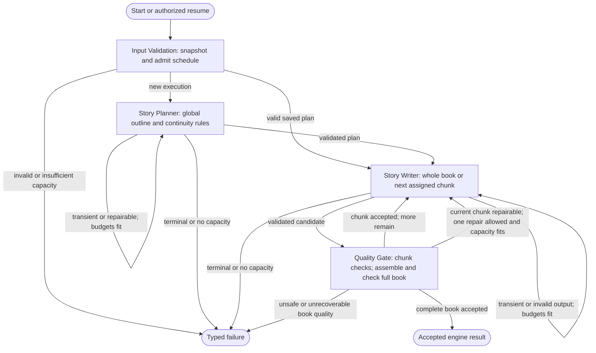

# AI generation reliability design

> Superseded implementation direction: the user approved whole-book hardening
> only. Chunking, checkpointing and new orchestration are excluded. See
> [implemented scope and current calibration](WHOLE_BOOK_RELIABILITY.md). Chunk/job
> proposals below remain historical, unimplemented and unapproved.

Status: **design for review; nothing below authorizes implementation or live calls**.
Owner: Agent 1, AI generation engine. Reviewed against the repository on
2026-11-05, based on `ec33b93` and `7105be9`. Existing model settings, budgets,
three-attempt limit, public contracts and deployment remain unchanged.

Agent 3 owns backend jobs, authentication, persistence and canonical Book/BookPage
contracts. Subsequent read-only review located its Phase A working-copy design;
see the [proposed integration contract](AI_BACKEND_INTEGRATION_CONTRACT.md).
Section 9 and that contract remain proposals pending joint approval.

## 1. Assessment and evidence

| Verified fact | Evidence / implication |
| --- | --- |
| Four explicit nodes | `orchestration/engine.py`: Input Validation, Planner, Writer, deterministic Quality Gate; no supervisor, checkpointer or external tracing |
| One Writer generates the entire book | `prompts/v2.py` supplies normalized brief plus the full validated plan; `StoryV2.validate_for` requires all requested pages |
| User controls length | `StoryRequestV2.page_count`, `validation/normalization_v2.py`, configurable `PagePolicy`; age controls strategy/density, not page count |
| One shared budget | `AppSettings.max_attempts <= 3`, `RunState` also rejects more than three; every provider attempt reserves tokens/cost before awaiting |
| Retry is application-owned | SDK retries and LangGraph node retries are one attempt; Gemini/OpenAI adapters are single-call boundaries |
| Backoff is incomplete | Engine honors parsed Retry-After/RetryInfo but has no default exponential jittered delay |
| Diagnostics are safe and distinct | `ProviderDiagnostic` on failed attempts; terminal `stop_reason` separate from existing public `error.code` |
| HTTP execution is connection-bound | `api/execution.py` cancels generation on disconnect; request-local asyncio tasks are drained |
| No durable job or accepted-book store | Session journal and state live in memory; `generate` initializes a new execution each time |
| Local API lacks owner authentication and idempotency | These commercial backend responsibilities are not present in the generation routes |
| Sizing is heuristic | `PagePolicy` uses per-language token/word estimates; input reservation uses UTF-8 bytes plus schema/framing, not an exact tokenizer |

The ordinary application still defaults to Fake. The isolated live-test runtime
in `docs/examples/roy-alphabet-runtime.v2.proposed.json` selects
`gemini-3.5-flash-lite` for both stages through the Gemini Developer API's
`v1beta` generateContent endpoint. Separate stage models are supported, but there
is no automatic fallback and no language-dependent model routing.

Prior explicitly approved live observations, inspected through safe execution
metadata only; no names, prompts, story text or credentials are reproduced:

| Experiment | Result | Interpretation |
| --- | --- | --- |
| 27-page Hebrew alphabet | Planner succeeded; both Writer attempts received upstream HTTP 503; terminal `BUDGET_EXCEEDED` / `attempt_capacity_exhausted`; 10.85 s HTTP elapsed | Actual upstream service failures; not established as monetary exhaustion, truncation or schema rejection |
| Two-page English bedtime control | Planner and Writer succeeded; deterministic gate passed; 2 calls; 4.62 s; reported 1,900 input / 447 output tokens; estimated $0.0016875 | This model/endpoint/schema can work for a short request at that time |

**Unknown:** why the provider returned those 503s. Workload size, language,
educational constraints and time differed between experiments. One small success
does not prove the larger workload caused the failures. Neither observation
establishes a commercial availability or literary-quality threshold.

Google recommends bounded backoff and jitter for transient errors. This is a
reason to improve retry scheduling, not evidence that it would have rescued the
failed book. [Official guidance](https://aistudio.google.com/docs/troubleshooting#retry-strategy).

## 2. Recommendation and alternatives

**First harden whole-book generation and add an approved durable job boundary.
Evaluate sequential chunks as a separately budgeted long-book strategy; do not
make chunking the default based on two live experiments.**

| Strategy | Benefits | Costs / failure risks | Recommendation |
| --- | --- | --- | --- |
| Global plan + whole-book Writer | Two normal calls; full context; simplest coherent arc and global validation | A failed Writer loses the whole draft; large repair context; no partial resume today | Preserve as baseline and legacy behavior; use when admission fits |
| Global plan + two large chunks | Smaller per-call output; some reusable work | Three mandatory calls already consume the entire current limit; no retry/repair slot | Not a robust solution under the present policy |
| Global plan + sequential bounded chunks | Recover only the failed current chunk; explicit progress; lower per-call output | More calls and repeated input; seams; private state/persistence; needs a new global policy | Candidate for controlled offline evaluation, then separately approved paired live evaluation |
| Parallel independent chunks | Potential lower latency | Weak continuity; concurrent spend; conflicting facts; likely repair cost | Reject initially |
| One call per page | Fine recovery granularity | Up to 33 mandatory calls including planning; overhead, style drift and repetition | Reject initially |
| Silent provider/model failover or dynamic supervisor | May hide some outages | Unapproved privacy/model/cost changes and more failure paths | Out of scope |

For illustration only, if independent per-call success were p, a no-recovery
two-call book succeeds with p squared, while five mandatory calls require p to
the fifth power. Smaller requests might improve p, but correlated overload and
additional calls can erase that benefit; neither assumption is measured here.

Mode selection must be deterministic and versioned, based on admitted output/input
estimates and approved evaluation results. Page count never changes. Initially
keep whole-book mode; a future chunked mode is opt-in until its benefits are shown.
Do not automatically switch modes after an error using a fresh budget.

Service support for **up to 32 requested pages** means exact length and explicit
admission/failure behavior. It does not mean every age/density request fits every
runtime. In particular, the existing isolated runtime cannot admit 32 pages under
the current Planner estimate. Commercial coverage requires reviewed capacity
profiles, not an assertion that the request contract alone provides capacity.

## 3. Proposed LangGraph flow

Retain the four named nodes. Writer performs at most one provider invocation per
visit. Chunk assembly and scheduling are pure operations inside the existing
nodes; the graph is not a supervisor or a second retry loop.



Retry delay runs through the shared scheduler before dispatch, outside any
database transaction. Node retry policies remain `max_attempts=1`; recursion
limits are a secondary guard derived/tested against bounded chunks and recovery
paths, not a substitute for attempt accounting. The current recursion limit 16
must not be assumed sufficient for arbitrary chunk counts.

### Long-book contracts and continuity

Proposed **engine-private**, versioned additions, not shared backend schemas:

- An execution schedule: whole/chunked mode, ordered disjoint page ranges,
  per-call input/output caps, required remaining calls and global recovery budget.
- A compact global plan: every page's purpose and progression, goal/closure or
  sensory sequence, ordered educational assignments, motifs and deliberate
  variation. A baby book still needs no conventional conflict or six-beat plot.
- A bounded continuity specification: exact protagonist name, supplied pronouns,
  character attributes, setting rules and planned events. Never infer gender or
  child facts. Include this global context in every chunk.
- A chunk candidate: absolute page numbers and server-assigned stable page IDs
  for its exact range. This cannot be validated as a complete `StoryV2`: its
  numbering may start after one and its count differs from the requested book.
  Use a private strict chunk contract; assemble `StoryV2` only at completion.
- A resume snapshot: configuration/prompt/schema versions, validated plan and
  chunk revisions, dependency fingerprints, attempts/reservations and expiration.
  No SDK clients, credentials or raw provider responses in snapshots.

Candidate batch size for evaluation: up to eight contiguous pages, with a
deterministic partition such as 1-8, 9-16, 17-24, 25-32. This is an engineering
hypothesis, not a proven reliability optimum. Token admission may require a
different reviewed partition. Bound the number of chunks before planning starts.

Default to sequential chunks. Include the global plan, fixed continuity facts
and a bounded tail of the last accepted chunk, rather than every previous page.
Record planned events already covered deterministically. Initially add no paid
summarizer. If a future Writer emits a continuity delta, give it a typed cap and
include its output tokens in admission; it cannot overwrite fixed facts or become
trusted system instructions. Changed context invalidates dependent chunks.

Preserve exactly one ordered educational target per assigned page. Final-form
base/example data remains generic request data, not Hebrew-specific routing.
Ordinary words may contain other letters. Require progression across the whole
book, not repeated standalone rescues at each chunk boundary. Prompts should vary
actions, openings and discoveries while allowing age-appropriate refrains.

Hebrew and English remain the only executable languages. Each future language
pack needs reviewed pronouns/agreement, direction, counting/segmentation,
developmental guidance, token sizing and evaluation fixtures. Whitespace word
counts and the current Hebrew/English ratios must not be generalized worldwide.

### Quality and partial recovery

Check each chunk's range, IDs, targets, words, metadata, controls and narrow safety
rules before accepting it internally. Only a complete assembly receives the
existing whole-book gate: exact N pages, contiguous order, unique IDs, all target
assignments/examples, total length, personalization, script evidence and safety.
Never publish a partial book, silently renumber bad output or omit failed pages.

Native/adult review must assess continuity, child agency, grammar, accurate
teaching, repetition and read-aloud experience across seams. Repetition and
sentence/vocabulary guidance remain advisory; no unapproved soft rule becomes
a hard rejection. Current literal target checks do not prove educational accuracy.
The gate remains LLM-free. A semantic judge or moderation service needs a separate
quality, privacy and call-budget decision before commercial release.

Retry the current failed chunk, keeping accepted predecessors and the same plan.
Allow at most one current-chunk quality rewrite per workflow, sharing all spare
calls with transport/schema recovery. Initially do not automatically repair an
earlier chunk after descendants exist: global semantic rejection ends the job,
retaining only permitted private validated artifacts. A later dependency-aware
repair policy must reserve regeneration of all affected descendants first.

## 4. Bounded retry scheduling

Proposal requiring approval: inject a versioned scheduler, clock, sleep and RNG
at composition alongside existing settings. It must operate before every retry
through the same ledger. No retry in HTTP handlers, workers, SDKs or queue delivery.

For transient retry index k starting at zero within the current operation:

```text
ceiling = min(8 seconds, 1 second * 2**k)
jittered_delay = ceiling/2 + uniform(0, ceiling/2)
delay = max(valid_provider_retry_after, jittered_delay)
```

The proposed coefficients are provisional, not deployed. A long provider delay
must not be shortened to the jitter cap; stop if it cannot fit. Before waiting,
check cancellation, the remaining global attempts, token/cost reservations, and
whether delay plus a configured useful-call allowance and mandatory remaining
work can fit the deadline. Recheck immediately before dispatch. No slot or paid
attempt is consumed merely by sleeping; no counters reset on chunk boundaries.

503 and appropriate transient 5xx/408/429 errors use this path. Preserve safe
categories; do not infer persistent quota exhaustion from 429 alone. Recognized
permanent quota/permission/configuration errors should terminate under a reviewed
classification policy. Broad current retry treatment of transport errors, 409,
501 and 505 needs explicit review; deterministic TLS/configuration faults should
not be retried indefinitely. Refusal/unsafe content remains terminal.

Separate recovery modes: transient errors replay the same semantic payload;
schema errors receive bounded static repair instructions; a valid draft failing
quality receives only safe repair issues. The current Writer adds
`schema_recovery` after any error, including 503; propose correcting this without
returning raw invalid outputs or validation inputs. Truncation gets no automatic
token increase. Repeated truncation under an unchanged cap fails explicitly.

The scheduler does not add attempts. With the current limit, two failed Planner
attempts still prevent a third because a Writer slot must remain. For chunks,
admission must reserve **all unfinished mandatory calls**, not today's single
future Writer reservation. Validated quality repair, schema recovery and every
transport invocation count against the same global maximum.

## 5. Token, cost and latency arithmetic

Existing `PagePolicy`, for N pages and maximum W words/page:

```text
P = 200 + 96*N
B = 456 + N*(40 + ceil(W*language_ratio))
language_ratio: English 2.0; Hebrew 4.0
cost = (input_tokens*input_rate + output_tokens*output_rate)/1,000,000
```

The 456 Writer base includes a 256-token thinking allowance. Values are heuristic;
candidate chunk/bible schemas require fresh sizing. Use separate actual stage
tariffs and capabilities; cached discounts do not reduce reservations. Unknown
usage keeps reservations. Estimates are never guaranteed invoice caps.

The unchanged isolated runtime has input cap 32,000/call, output ceilings
3,000/6,000, 111,000 aggregate units, $0.075, three attempts, 45 s/attempt and
135 s overall. Rates used below are its declared $0.30/M input and $2.50/M output,
matching the [published standard table](https://aistudio.google.com/docs/pricing#gemini-3.5-flash-lite)
checked for this design. These calculations neither assume free usage nor approve
new prices, model settings or budget classes.

| Whole-book case | P | B | Three-call bound: 3*32,000 + P + 2B | Reserved USD |
| --- | ---: | ---: | ---: | ---: |
| 2 pages, English, light preschool W=24 | 392 | 632 | 97,656 | 0.03294 |
| 27 pages, Hebrew, light preschool W=24 | 2,792 | 4,128 | 107,048 | 0.05642 |
| 32 pages, Hebrew, light preschool W=24 | 3,272 | 4,808 | 108,888 | 0.06102 |
| 32 pages, Hebrew, older standard W=70 | 3,272 | 10,696 | 120,664 | 0.09046 |

For these rows B exceeds P, so Planner + two Writers is the largest three-call
output reservation. Thirty-two-page rows are arithmetic only: both exceed the
current Planner ceiling; older standard also exceeds Writer, aggregate and cost
limits. No valid request is shortened or silently assigned lighter density.
To serve all these cases, approve explicit capacity/price classes or reject them
before paid work. Do not advertise universal 32-page readiness yet.

For 27 pages, mandatory two-call full-input-cap reservation is 70,920 units /
$0.03650. The recorded Writer reservations imply conservative input bounds of
16,215 and 16,368, much lower than 32,000, but their actual provider usage is unknown.
The two-page control's actual $0.0016875 is one observation, not a linear cost
forecast for 32 pages.

### What chunking would require

Illustrative reuse of the existing formula with eight-page Hebrew light chunks:
each full chunk B=1,544; a final three-page chunk B=864. This excludes any extra
bible/continuity schema overhead; it is a comparison, not an approved allocation.

| Case | Chunks | Mandatory calls | With two shared recovery calls | Full-input-cap bound | Reserved USD |
| --- | --- | ---: | ---: | ---: | ---: |
| 27 pages | 8+8+8+3 | 5 | 7 | 237,872 | 0.10188 |
| 32 pages | 8+8+8+8 | 5 | 7 | 239,992 | 0.10718 |

For 32 pages the worst illustrated output is 3P + sum(chunk B)=15,992 when both
recovery calls retry the Planner. Four chunks duplicate 1,368 output-base tokens
versus one Writer, plus repeated input. Chunking therefore need not be cheaper.
Even mandatory five-call token reservations exceed the current 111,000 budget.

**A four-chunk pilot would need a separately approved global maximum of seven
calls (five mandatory plus two shared recovery), new validated stage allocations,
aggregate budget and deadline.** Seven is a candidate, not a deployed setting or
permission for seven attempts per chunk. `AppSettings`, `RunState` invariants,
two-call admission and future-work reservation must evolve together; do not
bypass their current three-call limits. No candidate is authorized here.

Latency for sequential work is the sum of calls, backoff and local/persistence
work. Three full 45-second calls already equal 135 seconds, leaving no headroom;
backoff must reduce remaining call time or stop, not extend the deadline. Seven
full calls require 315 seconds before overhead; two proposed retry waits add up
to three seconds. For illustration, allowing five seconds of local/storage work
gives 323 seconds. A future 360-second class could cover that arithmetic, but is
not an SLA or approved deadline. Queue waiting requires a separate expiry policy.
Do not estimate throughput or success rates from the two live samples.

## 6. Errors, accounting and compatibility

| Failure meaning | Existing public code | Safe discriminator / target behavior |
| --- | --- | --- |
| Provider temporarily unavailable | `PROVIDER_UNAVAILABLE`; may terminate as `BUDGET_EXCEEDED` | Attempt category/status retains upstream cause; terminal stop reason explains capacity |
| No remaining invocation capacity | `BUDGET_EXCEEDED` | `attempt_capacity_exhausted`; do not describe as insufficient funds |
| Internal request USD reservation limit | `BUDGET_EXCEEDED` | `cost_budget_exhausted`; unknown usage is not free |
| Token/input capacity | `BUDGET_EXCEEDED` | `token_budget_exhausted` / `input_capacity_exceeded`; no silent truncation |
| Deadline | `DEADLINE_EXCEEDED` | `deadline_exceeded`; attempt timeout remains in ledger if later retry capacity ends |
| Invalid provider output | `PROVIDER_OUTPUT_INVALID` | `invalid_output`; distinguish truncation internally only after a typed diagnostic extension is approved |
| Accepted-shape draft fails hard quality | `QUALITY_REJECTED` | `quality_rejected`; never return rejected content as success |

Keep v1/v2 codes and HTTP mappings unchanged. Existing additive diagnostics and
stop reasons remain authoritative; a job API can present their distinction more
clearly without changing legacy synchronous responses. Public `retryable=false`
at terminal exhaustion must not trigger clients to POST a fresh job automatically.
Any new public job error enum or HTTP policy belongs to Agent 3's versioned design.

Every dispatch reserves an attempt, input/output tokens and stage-priced cost
before I/O. A failed/unknown attempt stays charged conservatively. Resuming or
redelivering a job cannot reset any counter, version or reservation. Add job-level
and per-tenant aggregate admission controls before public use; per-request caps
alone do not protect against many small jobs. Provider cooldown/concurrency limits
must also be shared across workers, not multiplied by replica count.

## 7. Proposed async lifecycle and deployment

Current synchronous `execute_request` is correct for its present connection-bound
contract. A commercial job must outlive a polling client's disconnect. Add a
separate backend-owned asynchronous path; do not silently detach existing v2 POSTs.

1. Agent 3 authenticates an owner, validates mode/input and atomically creates a
   durable job plus idempotency record after admission. Return an accepted job
   reference, not a speculative Book. Exact routes/DTOs remain undecided.
2. A worker claims queued work using a lease and fencing/version token, loads
   frozen policy/engine snapshots, and runs the approved schedule.
3. Persist safe phase/page-count progress. Polling with bounded client backoff is
   sufficient initially; SSE is optional later. No raw tokens, prompts, rejected
   draft text or invented completion-time percentage in progress responses.
4. On complete engine acceptance, Agent 3 atomically persists the canonical book
   and links it to job completion. Never mark completed before the book is durable.
5. On terminal failure, persist the safe ledger and stop reason; do not publish
   partials or automatically create a new budgeted job.

Minimum public states: queued -> processing -> completed or failed. Proposed
internal phases include planning, writing, retry_wait, checking and finalizing.
Cancellation uses a request flag and cooperative cancellation; Agent 3 must agree
whether cancelled is a separate public terminal state or a failure reason.
Polling disconnect does not cancel a job; explicit owner cancellation does.

Scope idempotency keys to owner and operation; compare a keyed fingerprint of
normalized input plus approved policy versions. Same key/same input returns the
same job, including after completion; same key/different input is a conflict.
Concurrent submissions require atomic uniqueness, not a process-local dictionary.
Key retention and explicit regeneration behavior need product/backend approval.

Set queue expiry independently. Freeze execution expiration at first processing;
retry waits, crashes and resume do not reset it. Persist UTC expiration using an
authoritative clock, then derive remaining monotonic time per worker. Do not
persist and reuse one process's `time.monotonic()` values on another host.

### Minimal justified infrastructure

Durable jobs, ownership and recovery justify storage and a worker boundary.
Recommend using Agent 3's selected transactional store for job records and claims
first, if its capabilities/load fit. Same repository/artifact, separate API/worker
entrypoints; no requirement for microservices, Redis, Celery or managed LangGraph.
There is no product database today, so this is a dependency and release blocker,
not implemented infrastructure or a unilateral database selection.

In-memory tasks/FastAPI BackgroundTasks can support local experiments but cannot
provide this design's restart durability or cross-worker ownership. A broker may
be justified later by measured polling load, dispatch latency, fairness or scale;
it adds an outbox/delivery-consistency problem, not free exactly-once execution.
FastAPI discusses separate tooling for multi-process/server workloads in its
[background-task caveat](https://fastapi.tiangolo.com/tutorial/background-tasks/#caveat).

### Recovery and exactly-once limits

Persist engine-private versioned snapshots through a backend storage port at
validated plan/chunk boundaries. Atomically journal reservations before dispatch,
then usage/outcome and accepted chunk revision after validation. Keep one source
of truth for budget and state. Generic LangGraph checkpoints alone do not make
provider calls transactional; adopting a durable checkpointer requires a reviewed
commit/fencing/retention design. An in-memory saver is not restart durability.
[LangGraph persistence](https://docs.langchain.com/oss/python/langgraph/persistence).

If a worker crashes after dispatch but before recording the response, the outcome
and billing may be unknown. Preserve the slot/reservation. Do not automatically
replay an in-flight call because its lease expired. Reconcile or consume another
already-approved spare slot under an explicit recovery policy. Without provider
idempotency support, exactly-once external generation/billing cannot be promised.

Claim fencing prevents stale workers from publishing results; atomic job/book
completion and a unique completion revision prevent duplicate books. It cannot
recall an already accepted remote request. Cancellation checks occur before and
after waits/calls and before finalization. Cancellation/finalization races use an
atomic state/version decision; once completion wins, cancellation must not delete
an accepted book. Shut down workers by stopping claims, draining/cancelling bounded
work and retaining uncertain reservations. Never run paid startup/health probes.

## 8. Privacy, security and operational release gates

Persist only the normalized inputs and validated plan/chunks needed for approved
resume, encrypted and access-controlled. This changes today's no-persistence
policy and needs explicit approval of retention, deletion and access. Keep child
content out of URLs, logs, metrics, errors and traces; no global cross-user prompt
cache or RAG. Discard unsafe raw output rather than checkpointing it. Raw provider
exceptions, bodies and headers remain excluded. Request flags such as `store=False`
do not establish provider training/retention guarantees; review provider terms.

Authorize job polling, cancellation, book access and any permitted recovery by
owner/tenant, not possession of a job ID. Backend workers use least-privilege
credentials; clients never choose arbitrary provider endpoints or credentials.
Keep untrusted user guidance, target labels and generated continuity context as
data, not trusted instructions. Do not infer additional child attributes.

Before commercial release, agree content safety/native-language review policy,
data retention/deletion, ownership checks, aggregate spend limits, rate/concurrency
admission, and operational support. Deterministic Quality Gate success alone is
not a safety or literary-quality guarantee. Track completion/failure by language,
band, page/density class and provider/model; latency percentiles, known/unknown
cost per accepted book including failed jobs, retries and stop reasons. Define
release SLOs only after a reviewed evaluation; one short success is insufficient.

## 9. Agent 3 coordination and canonical book boundary

Agent 1 supplies a fully accepted `StoryV2` and safe execution report, plus an
opaque private resume snapshot for the worker boundary. Agent 3 owns adapters
into the canonical Book/BookPage representation; engine-specific profiles,
attempts and prompts must not become required fields for every book mode.

| Joint decision needed | Agent 1 requirement / Agent 3 ownership |
| --- | --- |
| Canonical content mapping | Preserve exact title, ordered page content, sentence-unit boundaries where useful, language/direction and stable page identity; exact field names/version owned by Agent 3 |
| Creation modes | AI_GENERATED calls this engine; TEMPLATE_BASED and MANUAL bypass it and produce the same canonical representation through their own paths |
| Counting and lifecycle | Requested N means story pages, not covers/print sheets; accepted AI output can become a canonical draft, not automatic print/publication approval |
| Job and idempotency contract | Backend owns routes, public statuses, identity, deduplication and cancellation races; engine needs one immutable execution ID and frozen policy |
| Durable ports | Backend supplies atomic claim/lease, reservation journal, private checkpoint, progress and finalization transactions; interface sketch is a requirement, not shared code in this task |
| Budget/deadline semantics | Retries/resume use the same execution ledger; queue age and active deadline policy must be explicit |
| Recovery and privacy | Agree outcome-unknown handling, checkpoint retention/deletion, owner-only retrieval and human-review access before storage is enabled |

No canonical schemas, product database, template catalog, manual editor, queue or
shared API contracts are modified by this document. Agent 3 review remains pending.

## 10. Migration and phased implementation proposal

Each phase needs approval; this design does not start Milestone 7.

| Phase | Deliverables | Acceptance / tests |
| --- | --- | --- |
| 1: bounded retry hardening | Injected delay policy, transient-vs-schema recovery modes, precise safe stop diagnostics; retain four nodes, current three calls and budgets | Seeded jitter bounds; Retry-After; no-call-on-insufficient-deadline; cancellation during wait; same codes/attempts/cost holds; both SDKs remain single-call |
| 2: backend agreement and durable whole-book jobs | Agent 3-approved ownership/canonical/job contracts; private storage/worker ports, idempotency, atomic completion, explicit resume | Concurrent duplicate keys; restart before/after dispatch; outcome unknown; fencing; expiry/cancel/completion races; one canonical book; no private progress leaks |
| 3: offline long-book prototype | Private chunk contracts, global continuity plan, bounded sequential schedule and whole-book assembly; separate proposed execution policy | N=1/2/8/9/16/17/27/32; both languages/all age bands; exact target ranges; missing/duplicate/out-of-order chunks; budget/resume equivalence; seam failures and one shared repair cap |
| 4: separately approved paired evaluation | Compare whole-book vs candidate chunk sizes on matched language/age/story constraints with reviewed human rubric and explicit per-run caps | Measure completion, coherence, repetition, education, latency and total cost including failures; randomized run order to limit temporal confounding; no paid run in default pytest |
| 5: controlled rollout | Only the reviewed strategy/policy classes; monitored concurrency/spend and rollback switch | Observe defined SLOs and failure thresholds; stop new admissions on incidents without discarding committed books or resetting budgets |

Preserve deprecated `/v1` and current synchronous `/v2` behavior during migration.
Do not turn disconnect cancellation into durable jobs behind those routes. Keep
their schemas/public codes; introduce job APIs only through Agent 3's reviewed
version. Chunked internal outputs assemble the same accepted `StoryV2`; canonical
mapping stays backend-owned. Reject unsupported snapshot versions or migrate
explicitly; never resume old work with a silently changed prompt/model/policy.

## 11. Offline verification and proposed test coverage

Current checks run without credentials/live requests:

- **360 passed, 0 failed** on Python 3.13.3 (78.36 seconds): existing engine,
  v2 contracts/execution, provider diagnostics and API checks. No test changes.
- Pure arithmetic reproduced 27-page admission and 32-page
  `BUDGET_EXCEEDED` under the unchanged isolated runtime, plus the tables above.
- Verified the incompatibility of planner + four chunks with the current hard
  three-call settings/state invariant. Hypothetical chunk costs are calculations,
  not execution results or performance measurements.

```powershell
.\.venv\Scripts\python.exe -m pytest tests/test_engine.py tests/test_v2_contracts.py tests/test_v2_execution.py tests/test_provider_diagnostics.py tests/test_api.py -q
```

Future offline coverage must add deterministic fake clocks/RNG and mocked SDK
transports for global retries across chunk boundaries; stage-specific pricing;
unknown usage after crashes; cap overruns; malformed/truncated outputs; terminal
safety/refusal; fixture-based continuity and exact educational order; payload-bound
overflow after a valid plan; no extra semantic/summarization calls; immutable
versions; idempotency tenant isolation; redelivery without reset; cancellation
during provider wait, retry wait and finalization; and fault injection around each
storage transaction. Persisted tests use synthetic data, never local live artifacts.

## 12. Decisions requiring approval

1. Retry delay coefficients and classification refinements, without raising
   today's attempt/monetary/deadline limits.
2. Agent 3's job/canonical ownership contracts and the minimum durable storage /
   worker design, including privacy/retention and exactly-once limitations.
3. Whether to evaluate chunks; candidate chunk size, compact-plan/continuity caps,
   and a distinct global policy. Seven attempts and a longer deadline are examples
   requiring approval, not new defaults. Approve complete per-class cost/token
   admission, including older-child/high-density cases, before a paid pilot.
4. Evaluation rubric, bilingual/native reviewers, safety/release thresholds and
   budget for matched live experiments. Chunking has not been proven superior.
5. Additional language packs, provider expansion, model fallback or automated
   semantic judges only in separately scoped work.

No model, budget, retry limit, production code, shared backend contract or
infrastructure was changed. No additional live Gemini call, merge, push or
deployment was performed. Stop for review.
