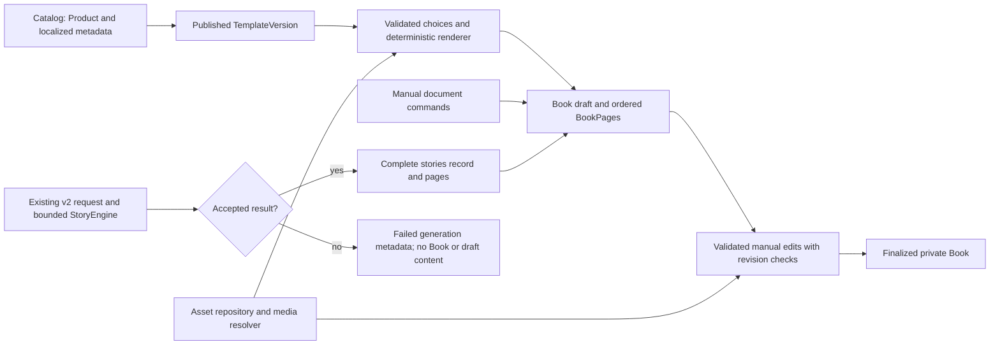

# Architecture

> **Phase A product design, 2026-11-05:** the proposed three-mode product architecture is specified below and in [DATABASE_SCHEMA.md](DATABASE_SCHEMA.md) and [API_CONTRACTS.md](API_CONTRACTS.md). It is awaiting approval; no product schema, renderer, editing service or new API has been implemented. Existing engine sections below remain the implemented baseline. Their historical no-persistence/product scope does not describe the separately accepted persistence foundation.

## Proposed product architecture: one Book, three creation modes

`Product` is a discoverable catalog offering, not an individual customer book. `Template` is an authored family belonging to a product. `TemplateVersion` is a language-specific authored revision containing a personalization schema, ordered page documents, layout and asset references. `Personalization` is the validated choice snapshot for one instantiated book. `Book` is the private individual work, and `BookPage` is its ordered editable content. `Asset` identifies externally stored immutable media. These are separate identities with explicit references; no commerce or user tables are proposed in this phase.

The generation lifecycle `pending -> processing -> completed/failed` stays in `stories`. Book lifecycle is separately `draft -> finalized -> archived`, with `draft -> archived` also allowed. Finalized is a private, immutable finished document, **not public publication** and not a claim of AI quality approval. The requested published-book concept is represented by this customer-ready finalized state; public sharing/distribution requires a separate access-policy decision. Catalog publication is a third lifecycle. A failed generation has a story ID but no Book. Template and manual creation make Books without synthetic story records, provider calls or fake usage. AI completion creates its source story and Book projection in one database transaction. Legacy completed stories remain retrievable through the accepted repository; historical Book projections are migrated only through an explicit backfill.

AI uses the public bounded engine and unchanged four graph nodes, budgets, retries, admission, quality and provider protections. A service adapts an accepted StoryV2 into PageDocument v1, retaining source page IDs and target IDs. Immutable `stories` remain the source approval record. Later edits affect BookPages only; original quality/usage metadata is labeled source metadata and never certifies edited content. Template rendering makes zero AI calls. Manual finalization performs structural/content-policy validation, not an invented AI quality pass.

### Typed documents and deterministic personalization

Use strict, extra-forbidden Pydantic discriminated models, not arbitrary JSON dictionaries at public/service boundaries. `PageDocument` v1 contains an allowlisted layout preset and ordered `text`/`image` blocks. Text has sentence units, explicit language/direction and a style token from a registry. An image references a normalized page asset slot; position/crop data is bounded finite numeric geometry. No HTML, Markdown execution, CSS, JS, URLs or executable expressions. Unicode stays in logical order. Document schema, personalization schema, renderer, layout registry and policy versions are independent named versions, not reused API version numbers.

`PersonalizationSchema` v1 defines stable field IDs; type-discriminated text, choice, boolean or bounded integer fields; required/default rules; supported options; and localized labels/help. Example: required child name, finite character/cover-color options and optional dedication. No inferred gender or appearance. Author constraints cannot expand centrally configured server limits. Defaults are validated using the same rules; no real-child default values. Unknown fields/options/locales, missing required inputs and type coercion fail safely. Field localization is separate from story language; template publication requires every supported locale to be complete.

TemplateDocument v1 uses text segments `literal`, `field` and bounded `select` branches over declared choice fields. Insertion is plain text, never reparsed as syntax. No `eval`, Jinja, traversal, arbitrary functions, file/network access or recursion through personalized values. Image options resolve only to version-pinned editorial asset slots. Fixed length uses one page sequence; configurable length uses a finite authored set of named page variants, each an explicit ordered list of page keys. The customer chooses a variant; the renderer does not pad, truncate or derive count from age/name. Richer algorithmic book assembly requires separate design.

Publishing seals the complete template-version aggregate: personalization rules, translations, page variants, page documents, asset bindings and renderer/layout versions. Corrections create a new version. Existing Books retain pinned source IDs, resolved choices, actual rendered pages and the small source metadata snapshot needed for display. Product text edits, release-pointer changes and template retirement do not rerender existing Books. Referenced assets have immutable object keys/checksums; replacing media creates a new Asset. A catalog preview uses synthetic public sample content, never a customer's personalized Book.

### Proposed modules and dependency direction

| Module | Exact responsibility |
| --- | --- |
| `domain/books.py`, `domain/documents.py` | Book origin/lifecycle, document/block unions, geometry, ordered-page and revision invariants; no ORM/HTTP/provider imports |
| `domain/catalog.py`, `domain/personalization.py` | Product/template/version/localization and typed personalization contracts |
| `application/ports.py` | CatalogRepository, BookRepository, TemplateRepository, AssetRepository, unit-of-work and media-resolution protocols |
| `application/books.py` | Create/read/list/edit/finalize/archive use cases, authorization checks and atomic revision-checked commands |
| `application/templates.py` | Select published version, validate choices, preview in memory or instantiate an atomic Book snapshot |
| `application/ai_books.py` | Preflight using existing normalizer/config snapshot, call existing request-scoped engine execution, adapt only accepted result, save atomically; no provider policy |
| `personalization/validation.py`, `personalization/rendering.py` | Pure bounded schema validation and deterministic AST rendering; no database/network |
| `api/book_routes.py`, `api/catalog_routes.py`, `api/template_routes.py` | Proposed additive v3 routers; request/response translation only |
| `api/contracts/books.py`, `catalog.py`, `templates.py` | Named OpenAPI DTOs; never serialize ORM entities directly |
| `api/product_dependencies.py` | Explicit feature gates, configuration, request access context, service construction and DB lifecycle |
| `persistence/models.py` plus `catalog_models.py`, `book_models.py` | Retained source tables and new relational mappings, constraints/indexes; no renderer or LLM calls |
| `persistence/repository.py`, `book_repository.py`, `catalog_repository.py`, `unit_of_work.py` | Async repository operations and explicit shared transactions; preserve existing public repository signatures |
| `infrastructure/media.py` | Resolve authorized asset IDs to approved delivery references; no binary upload/illustration generation in this phase |
| `tests/product/`, `tests/postgresql/` | Pure/API tests versus opt-in real database scenarios, including all three modes |

Dependencies point routers -> application -> domain/ports; persistence and media implement ports. Existing StoryEngine is injected into the AI use case; LangGraph and provider adapters remain independent of persistence. No dependency, queue, distributed workflow, CMS frontend, asset-upload service, export renderer or commerce engine is added by this design. Future illustrations attach Asset records; future exports consume finalized PageDocuments. Neither runs now.

### Branch dependencies and required approval

Read-only inspection on 2026-11-05 found the following independent branches sharing `5ae24e9`. Nothing was merged or cherry-picked.

| Owner / branch tip | Contract inspected | Integration consequence |
| --- | --- | --- |
| Agent 1 `fix/provider-diagnostics` at `7105be9` | `docs/PROVIDER_DIAGNOSTICS.md`; implementation `ec33b93` | Adds safe per-attempt diagnostic metadata and failure stop_reason; existing code/status mappings stay. Existing persistence allowlist deliberately does not store diagnostics. Preserve this privacy choice, document omission, and reconcile error DTOs rather than broad-dumping usage. |
| Agent 2 `feature/storyforge-frontend-foundation` at `c2b72c2` | `docs/FRONTEND_HANDOFF.md`, `frontend/src/api/contracts.ts` | React mock-first UI; v2 StoryV2 reader only, no catalog/manual-editor/saved-book client. Agree v3 DTOs, revision headers and local access policy with Agent 2; retain current v2 reader. |
| Agent 4 `feature/storyforge-qa-foundation` at `4dca2ac` | `docs/QA_HANDOFF.md`; tests `136296c` | 37 additional offline HTTP scenarios, not PostgreSQL or frontend/backend E2E evidence. Reconcile additive diagnostics and new routes before integrated QA. |
| Agent 3 `feature/storyforge-persistence-foundation` | `0001`, accepted repository and handoff; design base `73ac933` | Accepted 14 PostgreSQL / 773 total prior tests; contains none of the three branches above. |

**Before shared API edits:** obtain approval for an integration branch/base and merges of Agent 1 diagnostics, Agent 3 persistence and Agent 4 QA; Agent 2 frontend is a separate approved integration dependency. Agent 3 must not independently merge them. `docs/ARCHITECTURE.md` is shared documentation: coordinate this Phase A diff with the eventual integrator. Reconcile overlapping FastAPI composition, dependency manifests/lockfiles, docs and error serialization there. Run combined regression tests; branch-local pass counts cannot be added to claim a merged-suite result. Phase B can begin only after design approval; Phase C additionally requires this branch reconciliation. Current documentation reading does not assert uninspected work is integrated or tested.

### Product references and design decisions for approval

The [Wonderbly catalog](https://www.wonderbly.com/) demonstrates discovery by age/theme/occasion. [ABC for You](https://www.wonderbly.com/personalized-products/abc-for-you-book) exposes a cover/interior preview gallery and name/character personalization. [Dared to Dream](https://www.wonderbly.com/personalized-products/dared-to-dream-book) exposes name/character/dedication choices and whole-book preview. Observed 2026-11-05; these are behavioral references, not copied content/artwork or evidence about their private architecture. StoryForge's derived design is a localized catalog, per-version choice schema and deterministic preview of its own authored content. No competitor educational claims, prices or content are adopted.

Approval points: additive v3 endpoints; separate generation/Book/publication lifecycles; immutable finalized Books and template releases; finite authored page variants; explicit AI persistence opt-in through v3 rather than the earlier unapproved v2 save-query proposal; local-only private use until authentication; server policy limits for editor/schema/preview sizes; migration/backfill and publication-trigger strategy in DATABASE_SCHEMA.md. No identities, commerce requirements or production release policy are silently decided.

> Approved page-count update: new work uses [explicit-length v2](PAGE_COUNT_V2.md). The user supplies page_count; age controls developmental guidance and page density. Deprecated v1 keeps its original behavior. Historical milestone sections below describe v1 unless labeled v2. No live calls were made in this follow-up; Milestone 7 remains unapproved.

Status: Milestones 1 through 6 implemented. Fake is the default; OpenAI/Gemini are available only by explicit opt-in. Developmental profiles remain provisional hypotheses. Milestone 7 requires separate approval.

## Boundaries

Package layout (Milestones 1 through 6 implement these boundaries; OpenAI and Gemini are the real adapters):

| Location | Responsibility |
| --- | --- |
| `src/storyforge/api/` | HTTP schemas, dependency wiring, status mapping; no prompts or provider logic |
| `src/storyforge/domain/` | Pydantic contracts, constraints, policy types; independent of FastAPI and provider SDKs |
| `src/storyforge/development/` | Versioned declarative age-band data, typed profile validation and pure month/language resolver; independent of orchestration and providers |
| `src/storyforge/orchestration/` | Graph, four nodes, routing, bounded execution state |
| `src/storyforge/prompts/` | Versioned planner/writer instructions and Hebrew/English requirements |
| `src/storyforge/llm/` | Provider protocol, fake adapter, selected real adapter, usage normalization |
| `src/storyforge/quality/` | Pure deterministic checks and versioned language rubrics |
| `src/storyforge/validation/` | Pure request normalization, safe validation errors and profile resolution |
| `src/storyforge/config.py` | Validated settings and model capabilities; no secrets in source |
| `tests/` | Unit, graph, API, adapter-contract, and opt-in evaluation tests |

API and graph depend on domain contracts. Nodes use the provider protocol and prompt builders. Adapters depend on their SDK, never the reverse. Construct dependencies at the application boundary; avoid global clients in domain modules.

## Developmental configuration

Resolve strict integer `age_months >= 0` during Input Validation. Do not accept years as an alternate internal representation, infer age from a birth date, or impose an unapproved maximum. Configure ordered `[min_months, max_months)` bands starting at zero, with a null final maximum for open-ended coverage. Reject gaps, overlaps, missing language profiles, invalid lengths, and unsupported narrative strategy IDs at startup.

Each `DevelopmentalProfile` contains stable band ID/version, month bounds, language-specific read-aloud mode, narrative strategy, vocabulary guidance, soft sentence-length targets, repetition guidance, and density recommendations with explicit hard/soft classifications. V2 developmental data contains no page counts or total-book lengths. Normalization derives total word ranges from user page count times selected density. Legacy v1 retains its original page/total ranges. The initial values are product hypotheses documented in the Product Spec, not scientific standards. Treat them as versioned declarative data rather than executable prompt fragments or age-based branches inside graph nodes.

Milestone 1 packages this data in `development/profiles.v1.json` and loads it explicitly using package resources. Nested frozen models and tuples keep snapshots immutable. Python model construction is strict (tuple collections); JSON boundaries accept JSON arrays. `StoryPlan.validate_for(brief)` and `Story.validate_for(brief)` explicitly enforce context-dependent structural contracts; constructing a standalone output cannot establish profile compliance or quality approval.

Pronouns use a language-discriminated contract: English specifies subject/object, possessive determiner/pronoun, reflexive and singular/plural verb agreement; Hebrew specifies subject/object, possessive and masculine/feminine singular agreement. Forms are supplied explicitly, not generated from names. These are technical representations of supplied forms, not curated product presets or guarantees of grammatical correctness. Additional agreement support needs a reviewed contract change. Omitted pronouns remain absent.

Settings are explicitly constructed or validated from supplied mappings/JSON; Milestone 1 reads no environment variables or secrets and supports only the fake provider. Model tokenization, pricing and model-specific capacity validation remain part of the real adapter milestone; no fake token/word conversion is presented as a capacity guarantee.

Milestone 2 adds `normalize_request` and `assess_story` as independently testable pure functions, not graph nodes. They share immutable injected `QualityRules` configuration and reuse `GenerationError`/`QualityReport`. Normalization resolves profile and rubric context without rewriting user text. Quality assessment accepts a typed story, JSON or mapping and sanitizes schema failures into reports. See [implemented interfaces and issue codes](VALIDATION_AND_QUALITY.md). Any terminal issue takes precedence over repairable issues. Advisory observations never block acceptance; inconclusive language evidence is explicit and does not claim language verification.

Resolve and snapshot one immutable profile per request so a configuration update cannot change it midway. Planner, writer, and quality checks consume that same snapshot. Band changes require no graph-routing changes. Baby profiles permit sensory sequences/refrains without a problem-resolution arc. No node imposes a universal six-beat plot or six-page count.

## Graph

Each node has one routing function with explicit destination literals. Retry and rewrite edges share the same budget; no independent nested retry loops. Quality Gate is deterministic in MVP and makes no LLM calls. A graph recursion limit is a secondary safeguard, not the business call counter.

The implemented graph uses immutable Pydantic `RunState` under a typed `GraphState` and request-local `Session` journaling of pre-await reservations. Only planner/writer call the asynchronous provider. Explicit LangGraph retry policies permit one node attempt; retries occur solely on conditional graph edges. No checkpointer is configured. The public wrapper handles cancellation, deadlines and safe result conversion without exposing internal drafts. Full state, budget, prompt and failure details are in [ORCHESTRATION.md](ORCHESTRATION.md).

## V2 contract composition

`ExecutionContracts` selects v1 or v2 request/output schemas, normalizer and prompts at composition time. Graph nodes, conditional routes, provider protocol, adapters and accounting remain shared. V2 normalizes `StoryRequestV2` into immutable developmental, `BookConstraints` and `ExecutionAllocation` snapshots. Page admission/sizing uses injected `PagePolicy`, outside age profiles and graph routing. V1 never falls back into v2 normalization or vice versa.

The v2 Planner emits N intents with explicit progression and ordered target assignments. The Writer emits N pages with stable IDs and sentence_units; joined text is derived. Both use the same developmental snapshot. The gate checks requested count and structure deterministically; semantic progression remains model work and human review. See [full v2 state contracts and migration](PAGE_COUNT_V2.md).

## Legacy v1 typed contracts (retained for compatibility)

Use Pydantic v2 models with forbidden extra fields and explicit bounds at every untrusted boundary. Use a typed state container for partial graph updates; runtime validity comes from domain-model validation and transition checks, not type hints alone.

| Contract | Required content |
| --- | --- |
| `StoryRequest` | Language, display name, strict integer `age_months >= 0`, theme, optional interests, narrative pronouns, guidance; no assumed upper age limit |
| `DevelopmentalProfile` | Band ID/version and bounds; resolved language-specific strategy, read-aloud mode, vocabulary, repetition, sentence targets, page/word constraints |
| `NormalizedBrief` | Validated request, resolved profile snapshot, language rubric version; constraints derived from configuration |
| `StoryPlan` | Language, title concept, protagonist, strategy ID, ordered page intents matching profile count; strategy-specific narrative elements, with no mandatory conflict for babies |
| `Story` | Schema version, title, language, direction (`rtl`/`ltr`), profile ID/version, variable-length ordered pages with stable request-local IDs, page numbers and text |
| `QualityReport` | Pass/fail; issues with code, severity, optional page number and repair guidance; check/rubric versions |
| `AttemptRecord` | Stage, attempt number, provider/model, prompt version, duration, token counts, usage source, estimated cost, outcome |
| `GenerationError` | Stable code, safe message, stage, retryable flag; no raw prompt or provider response |
| `GenerationResult` | Request ID, discriminated success/failure, accepted story only on success, quality/usage summary and total latency |

Graph state contains request ID, raw typed request, optional normalized brief/plan/draft/report/error, status, attempt records, attempts used, rewrite count, deadline, reserved/estimated cost, and captured configuration versions. Drafts remain internal. SDK objects, secrets, clients, and mutable pricing tables are injected dependencies, not state fields. Request-local state requires no checkpoint store.

Invariants: writer requires a validated plan; quality requires a validated draft; success requires a passing report; every attempted provider invocation consumes a slot before execution; terminal state has exactly one success or failure result. Preserve earlier attempt records through revisions.

Plan and story validation checks page counts and narrative requirements against the resolved profile, not a global six-item schema. Profile ID/version is server-assigned metadata, not an LLM-selected band. Technical output/token limits remain separate from audience age policy; a larger future profile must pass startup capacity validation rather than silently truncate stories or introduce an age cutoff.

## Implemented API

- `POST /v1/stories/generate`: synchronous typed request; HTTP 200 with accepted result.
- HTTP 422: input validation; 400: content-policy rejection; 502: unusable provider output; 503: transient provider unavailability; 504: deadline exceeded. Use 422 with `QUALITY_REJECTED` for a valid request whose generated story fails quality, distinguished by error code.
- HTTP 503 with `BUDGET_EXCEEDED` when generation cannot continue under server limits; configuration errors fail startup.
- Normalize framework validation errors into the documented error envelope. Include request ID and available usage on runtime failures; no failed story text.
- `GET /health`: process readiness only, no paid provider call.

Milestone 4 preserves the planned versioned route and `422 QUALITY_REJECTED` mapping; that code denotes generated quality failure, not necessarily invalid client input. Input-policy rejections map to 400, while provider-produced unsafe content maps to 502 by stage. Internal unexpected/configuration/result failures map to 500; cancellation maps to best-effort 499. Startup configuration errors still fail startup. See [the full mapping](API.md).

The application factory and async dependencies build a request-local engine with the existing default settings and local fixture provider. Resources load in lifespan and contain immutable configuration only. A boundary-only JSON validator preserves domain tuple/strict scalar semantics without parallel story DTOs. Sanitized route/exception handling produces existing success/failure contracts and server-generated request IDs. After body validation, a request-scoped disconnect watcher cancels and awaits engine execution; it is not a background job. No API-layer retries or quality checks are added.

No automatic client retry or idempotency guarantee: repeating a POST is a new generation and may incur cost. Cancellation stops further scheduling; an in-flight remote request may still be billed.

## Extension seams

Stable page IDs and versioned story contracts provide future inputs for illustration and editing. Printing consumes a later layout contract. Add optional stages only with a product requirement and tests; do not prebuild those systems.

## References

The graph design uses explicit [LangGraph conditional edges](https://reference.langchain.com/python/langgraph/graph/state/StateGraph/add_conditional_edges). Validate boundary data using [Pydantic models](https://docs.pydantic.dev/latest/concepts/models/). Verify exact dependency APIs when implementation versions are selected.

## Gemini composition (Milestone 6)

The configured factory selects Fake/OpenAI/Gemini through explicit server configuration, never story input. SDK-specific classes stay inside adapters/composition. Both real providers share existing capability validation and per-stage pricing; a pure composition-time reservation policy selects the appropriate projected schema outside graph nodes. Planner/Writer, conditional routing, Quality Gate and API routes do not gain vendor responsibilities. Gemini credentials, retries/continuation, usage normalization and pool ownership are documented in [GEMINI.md](GEMINI.md).
