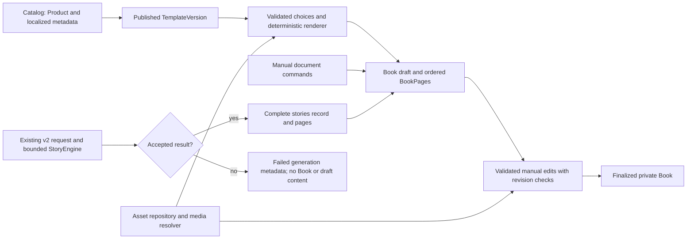
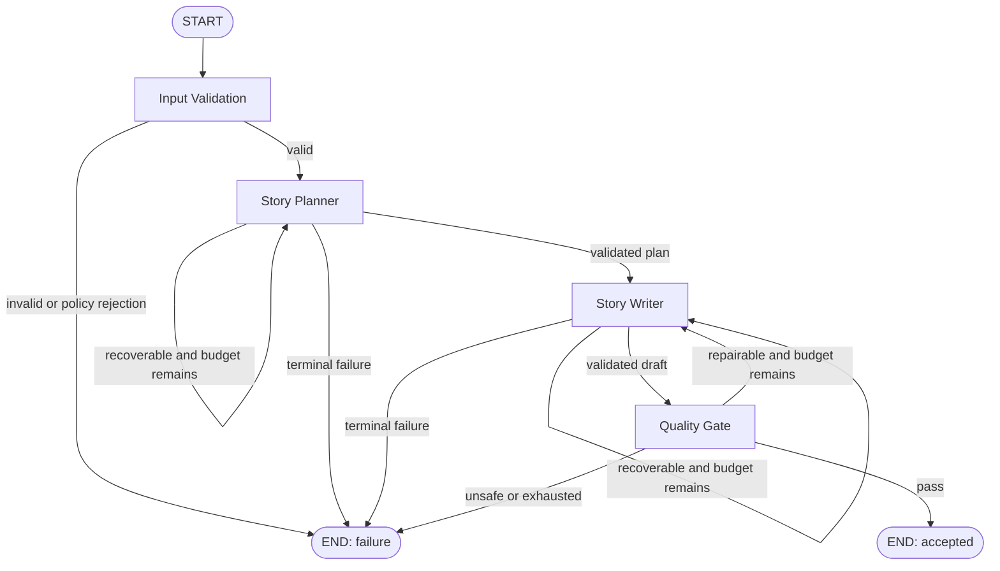

## Milestone 1 implementation boundary

The domain modules `documents`, `books`, `book_capacity` and `book_errors` contain strict,
HTTP-independent contracts. `application/ports.py` defines repository/unit-of-work protocols;
`InternalBookService` injects the unit of work and clock. SQLAlchemy implementation remains
in persistence modules. No engine, provider or private HTTP route invokes these services yet.

Agent 1 owns pure accepted-AI projection. This branch validates and saves its supplied canonical
BookDetail; it does not introduce another projector. Source completion and canonical Book/page
insertion share one transaction. Rejected, partial or failed output cannot become an accepted Book.
The internal service has no ownership enforcement and must never be mounted directly as a public
route. Milestone 2 must provide owner-scoped operations before private reads/writes are enabled.

# Architecture

> **Current delivery, 2026-11-05:** Phase B milestone 1 is implemented internally only: canonical Book/PageDocument, SQLAlchemy storage, migration 0002 and transactional services. No v3 routes, ownership, catalog, worker or quota implementation is enabled. Later design sections remain proposals. The latest session design is **7-day idle plus 30-day absolute expiry**, superseding the earlier fixed-30-day-only proposal. See [current handoff](PERSISTENCE_HANDOFF.md) and [expanded backend roadmap](BACKEND_ROADMAP.md).
> **Phase A accepted in principle, 2026-11-05:** the overall architecture including anonymous access, quotas, guest previews and private ownership is the planning baseline. Only milestone 1 coding was subsequently authorized and completed. The design below and in [DATABASE_SCHEMA.md](DATABASE_SCHEMA.md) / [API_CONTRACTS.md](API_CONTRACTS.md) is not executable functionality. Canonical internal Book storage is now implemented; session/quota/image services, renderer, full editor and new API remain unimplemented. Existing engine sections below remain the implemented baseline.

> **Current implementation planning baseline:** [PHASE_B_IMPLEMENTATION_PLAN.md](PHASE_B_IMPLEMENTATION_PLAN.md) divides future work into seven testable milestones. User-proposed defaults are UTC/10 story + 10 image units, durable first-dispatch consumption, proven-pre-dispatch release only, 7-day idle / 30-day absolute anonymous sessions, >=48-hour terminal replay, quota-free guest previews and separate async POST `/v3/jobs/stories`. Agent 1's latest contract `49410d0` now agrees on separate routes. These defaults guide later milestones; no later implementation, merge or live execution is authorized.

## Proposed product architecture: one Book, three creation modes

`Product` is a discoverable catalog offering, not an individual customer book. `Template` is an authored family belonging to a product. `TemplateVersion` is a language-specific authored revision containing a personalization schema, ordered page documents, layout and asset references. `Personalization` is the validated choice snapshot for one instantiated book. `Book` is the private individual work, and `BookPage` is its ordered editable content. `Asset` identifies externally stored immutable media. `AccessPrincipal` is the resource owner (anonymous or, later, authenticated); it is not a child identity. Minimal principal/session/quota records are now required design, while account registration/commerce remain separate systems.

The generation lifecycle `pending -> processing -> completed/failed` stays in `stories`. Book lifecycle is separately `draft -> finalized -> archived`, with `draft -> archived` also allowed. Finalized is a private, immutable finished document, **not public publication** and not a claim of AI quality approval. The requested published-book concept is represented by this customer-ready finalized state; public sharing/distribution requires a separate access-policy decision. Catalog publication is a third lifecycle. A failed generation has a story ID but no Book. Template and manual creation make Books without synthetic story records, provider calls or fake usage. AI completion creates its source story and Book projection in one database transaction. Legacy completed stories remain retrievable through the accepted repository; historical Book projections are migrated only through an explicit backfill.

AI uses the public bounded engine and unchanged four graph nodes, budgets, retries, admission, quality and provider protections. A service adapts an accepted StoryV2 into PageDocument v1, retaining source page IDs and target IDs. Immutable `stories` remain the source approval record. Later edits affect BookPages only; original quality/usage metadata is labeled source metadata and never certifies edited content. Template rendering makes zero AI calls. Manual finalization performs structural/content-policy validation, not an invented AI quality pass.

### Typed documents and deterministic personalization

Use strict, extra-forbidden Pydantic discriminated models, not arbitrary JSON dictionaries at public/service boundaries. `PageDocument` v1 contains an allowlisted layout preset and ordered `text`/`image` blocks. Text has sentence units, explicit language/direction and a style token from a registry. An image references a normalized page asset slot; position/crop data is bounded finite numeric geometry. No HTML, Markdown execution, CSS, JS, URLs or executable expressions. Unicode stays in logical order. Document schema, personalization schema, renderer, layout registry and policy versions are independent named versions, not reused API version numbers.

`PersonalizationSchema` v1 defines stable field IDs; type-discriminated text, choice, boolean or bounded integer fields; required/default rules; supported options; and localized labels/help. Example: required child name, finite character/cover-color options and optional dedication. No inferred gender or appearance. Author constraints cannot expand centrally configured server limits. Defaults are validated using the same rules; no real-child default values. Unknown fields/options/locales, missing required inputs and type coercion fail safely. Field localization is separate from story language; template publication requires every supported locale to be complete.

TemplateDocument v1 uses text segments `literal`, `field` and bounded `select` branches over declared choice fields. Insertion is plain text, never reparsed as syntax. No `eval`, Jinja, traversal, arbitrary functions, file/network access or recursion through personalized values. Image options resolve only to version-pinned editorial asset slots. Fixed length uses one page sequence; configurable length uses a finite authored set of named page variants, each an explicit ordered list of page keys. The customer chooses a variant; the renderer does not pad, truncate or derive count from age/name. Richer algorithmic book assembly requires separate design.

Publishing seals the complete template-version aggregate: personalization rules, translations, page variants, page documents, asset bindings and renderer/layout versions. Corrections create a new version. Existing Books retain pinned source IDs, resolved choices, actual rendered pages and the small source metadata snapshot needed for display. Product text edits, release-pointer changes and template retirement do not rerender existing Books. Referenced assets have immutable object keys/checksums; replacing media creates a new Asset. A catalog preview uses synthetic public sample content, never a customer's personalized Book.

### Proposed modules and dependency direction

| Module | Exact responsibility |
| --- | --- |
| `domain/books.py`, `domain/documents.py` | Book origin/lifecycle, document/block unions, geometry, ordered-page and revision invariants; no ORM/HTTP/provider imports |
| `domain/catalog.py`, `domain/personalization.py` | Product/template/version/localization and typed personalization contracts |
| `application/ports.py` | CatalogRepository, BookRepository, TemplateRepository, AssetRepository, unit-of-work and media-resolution protocols |
| `application/books.py` | Create/read/list/edit/finalize/archive use cases, authorization checks and atomic revision-checked commands |
| `application/templates.py` | Select published version, validate choices, preview in memory or instantiate an atomic Book snapshot |
| `application/ai_books.py` | Preflight using existing normalizer/config snapshot, call existing request-scoped engine execution, adapt only accepted result, save atomically; no provider policy |
| `personalization/validation.py`, `personalization/rendering.py` | Pure bounded schema validation and deterministic AST rendering; no database/network |
| `api/book_routes.py`, `api/catalog_routes.py`, `api/template_routes.py` | Proposed additive v3 routers; request/response translation only |
| `api/contracts/books.py`, `catalog.py`, `templates.py` | Named OpenAPI DTOs; never serialize ORM entities directly |
| `api/product_dependencies.py` | Explicit feature gates, configuration, request access context, service construction and DB lifecycle |
| `persistence/models.py` plus `catalog_models.py`, `book_models.py` | Retained source tables and new relational mappings, constraints/indexes; no renderer or LLM calls |
| `persistence/repository.py`, `book_repository.py`, `catalog_repository.py`, `unit_of_work.py` | Async repository operations and explicit shared transactions; preserve existing public repository signatures |
| `infrastructure/media.py` | Resolve authorized asset IDs to approved delivery references; no binary upload/illustration generation in this phase |
| `tests/product/`, `tests/postgresql/` | Pure/API tests versus opt-in real database scenarios, including all three modes |

Dependencies point routers -> application -> domain/ports; persistence and media implement ports. Existing StoryEngine is injected into the AI use case; LangGraph and provider adapters remain independent of persistence. Anonymous access and quota admission sit outside the graph. Image generation is a separate capability using the same access/admission ports, returning private Assets rather than pretending to be a story node. Image providers, durable asynchronous execution, uploads, export and commerce are not implemented by this revision; Agent 1's upcoming execution design is an explicit dependency.

### Anonymous ownership, account-free previews and later account transfer

Anonymous does not mean publicly readable. A visitor can browse catalog/schema/sample media without a session, then bootstrap an anonymous session without registration to generate stories/images, personalize/preview a template or explicitly save a private Book. A cryptographically random opaque cookie proves possession of one anonymous principal; resource UUIDs, IPs and browser owner-ID headers do not. Every private query, asset delivery and operation-status read includes authorized principal scope; foreign/missing IDs return the same 404. Session expiry/loss does not make data public or permit recovery by knowing a Book ID.

Proposed session: 256-bit random token, server-side keyed digest only; production `__Host-storyforge_session` cookie with Secure, HttpOnly, SameSite=Lax, Path=/ and no Domain. Use same-origin HTTPS frontend/backend, no tokens in URLs/localStorage or logs. The planning default is a fixed 30-day absolute lifetime from issuance, without a seven-day idle timeout or rolling extension; it does not set content retention. Rotate tokens without rotating the principal/quota identity or extending expiry; revoke previous tokens. Bind a synchronizer CSRF token to the session, return it via no-store bootstrap/status response for frontend memory and require it on cookie-authenticated mutations, together with exact Origin/Fetch-Metadata checks. No permissive credentialed CORS; bootstrap itself has origin/anti-automation protection and does not overwrite an existing valid principal. XSS/session theft remains a risk: render literal text and enforce CSP/no third-party child-data telemetry. These controls follow [OWASP session guidance](https://cheatsheetseries.owasp.org/cheatsheets/Session_Management_Cheat_Sheet.html) and [OWASP CSRF guidance](https://cheatsheetseries.owasp.org/cheatsheets/Cross-Site_Request_Forgery_Prevention_Cheat_Sheet.html); they do not replace ownership checks.

Template previews are deterministic, transient responses: no Book, saved personalization, provider call or AI quota entry. Request values remain in memory only, with response/body telemetry disabled and Cache-Control: no-store. Size/rate/concurrency limits still apply. Initially return rendered documents with editorial asset IDs; if raster previews later need temporary storage, require a separately approved short TTL and session-bound access, never public/CDN personalized URLs. Saving via from-template is an explicit separate command, allowed anonymously and owned by that session principal. A later authenticated account is optional for retention/access continuity, not a prerequisite for previews or generation. Session lifetime and data retention are separate; lost/expired sessions leave inaccessible data until an approved deletion policy purges it. Do not promise persistent access across devices without account linking.

Future claim flow requires both a verified account session and fresh proof of the anonymous session, CSRF protection and explicit adult confirmation. Atomically link that anonymous principal namespace to the account principal once, revoke anonymous credentials, and issue/rotate the account session through the real identity adapter. Existing Book/story/image/asset/operation owner IDs remain stable; the account is authorized for its own namespace plus successfully claimed namespaces. New writes use the account's canonical principal. Thus pending jobs cannot create orphaned or guest-readable results after transfer, and templates/source references need no ownership rewrite. Concurrent claims serialize; another account cannot reclaim a linked namespace. No email/name/Book ID is sufficient proof. Claim does not reset quota: aggregate today's usage/reservations across account and claimed namespaces; combined historical usage may exceed 10, in which case remaining is zero. Already admitted work is honored. Never transfer ownership based only on a resource UUID or a client assertion.

The future identity adapter must retain anonymous possession proof through login and bind it to the verified login context; it must not discard the guest cookie then accept an arbitrary principal ID as a substitute. Short shared principal gates for private reads/delivery serialize against claim/revocation. Already delivered bytes cannot be revoked, but old sessions cannot obtain new content afterward; private media needs an authorization-checking gateway or revocation-aware delivery token, not an indefinitely valid object URL. Exact claim proof handoff is an auth-integration approval dependency, not a newly implemented login flow.

### Daily capability quotas and admission policy

Product limit: **10 story creations and 10 image creations per quota principal per UTC calendar day**, separately server-enforced for anonymous and future account principals. Canonical account scope includes every claimed anonymous namespace. This is not a reliable per-human identity limit: clearing cookies, different devices or new accounts can evade a session-only counter. Registration is not required to address that risk; combine session issuance throttles, per-network-prefix burst controls, bot challenges when indicated, per-principal in-flight limits and provider/global spend/concurrency circuit breakers. Network signals are risk controls, not ownership or a blanket ten-per-household rule; shared NAT/IPv6/privacy accessibility impact needs review. Use short-lived rotating keyed network digests, not durable browser fingerprinting or raw-IP user profiles; trust forwarded addresses only from configured proxies.

One story operation (planner/writer/allowed retry or repair) uses one story unit, regardless of page count, within unchanged engine admission/budgets. One newly requested generated image uses one image unit; regeneration uses another; initial image API allows one output per operation, no hidden batch/variation loophole. A story containing requested generated illustrations must explicitly admit each image separately; no bundled bypass. Template rendering, editorial images, manual edits and retrieval use neither AI bucket.

Recommended semantics for approval: count admitted **AI creation attempts**, not only successful outputs. Validation/policy rejection before provider dispatch is free of daily units but still rate-limited. Reserve one unit atomically before accepting work; reserved units immediately reduce remaining. On durable first-dispatch authorization convert reserved -> consumed once; all provider errors/refusals, unsafe/rejected results, timeouts, uncertain sends and cancellation after dispatch remain counted. Internal allowed retries reuse the same unit and shared attempt/cost budget; a new user regeneration is a new unit. Release only a reservation proven cancelled/failed before any provider dispatch, with fencing that prevents a stale worker from subsequently dispatching. A crash or unknown provider outcome never automatically refunds or launches another provider call. Dispatched-but-unsaved work remains consumed. Expose this policy plainly in the UI, not as a promise of ten successful books/images.

All admissions use a shared PostgreSQL authoritative transaction, not process counters. Acquire/recheck canonical principal scope (claim-aware), lock its admission gate, compute the UTC date from database time after the gate is acquired, replay an existing idempotent operation if present, then check sum(consumed+reserved) across its quota namespaces for that capability/date. If <10, increment a bucket and insert the unique reservation + creation-operation record atomically; otherwise 429, no provider call. Source creation and any eventual outbox enqueue join that acceptance transaction. No database lock spans an LLM call. Separate story/image rows never cross-charge; a common short principal gate makes claim and alias aggregation safe. Details/constraints in DATABASE_SCHEMA.md. Midnight creates a new date key, not a scheduled reset; settlement stays attached to the original admission day even if execution finishes later. Use UTC/reset_at in API, localize display without changing the boundary.

Multi-process/region services must route admission and claim to one authoritative writer per principal (initially one PostgreSQL primary). Redis/edge throttles may supplement but never replace the durable daily counter. No eventually consistent multi-master quotas or per-pod allowances; DB/admission failure is fail-closed (503, no call). Idempotency requires a durable operation/reservation link: retries/reconnects do not consume another unit or redispatch. Account claim and settlement use the same locking/alias rules. Operation idempotency does not guarantee exactly-once provider delivery; unknown sends require Agent 1's reliability policy. Additional abuse caps may reject before daily 10; remaining daily allowance is not a spend authorization.

Additional proposed modules: `domain/access.py` and `domain/usage.py` for principal/quota/operation contracts; `application/access.py` for sessions/claim; `application/admission.py` for admission/idempotency/reservation settlement; `persistence/access_repository.py` and `usage_repository.py` for shared DB transactions; `api/access_dependencies.py` for session/CSRF scope. Token/HMAC keys are injected secrets, never database content or child-data logs. Interfaces to Agent 1: `AdmissionService.admit(principal, capability, idempotency_key, request_fingerprint) -> operation/reservation`, `authorize_first_dispatch(operation, lease)`, `settle(operation,outcome)` and authorized operation/result lookup. No reliability state machine is silently implemented here.

`application/images.py` will use the same admission/access ports with an injected image-generation port; provider implementation, safety disposition and async execution are Agent 1 coordination dependencies. It returns accepted private Asset references without changing LangGraph's four story nodes or persisting provider drafts. No image code or provider capability exists on this branch today.

### Branch dependencies and required approval

Read-only inspection on 2026-11-05 found the following independent branches sharing `5ae24e9`. Nothing was merged or cherry-picked.

| Owner / branch tip | Contract inspected | Integration consequence |
| --- | --- | --- |
| Agent 1 `docs/ai-generation-reliability-design` at `49410d0`; earlier contracts `e34b588` / `19d63f7`, diagnostics `7105be9` / `ec33b93` | Latest `docs/AI_BACKEND_INTEGRATION_CONTRACT.md` inspected read-only | Aligns separate async/sync routes, explicit cancelled operations, atomic first-dispatch daily/attempt/token/cost authorization, admitted frozen artifacts and replay/tombstones. Latest user instructions adopt seven-day idle plus 30-day absolute expiry. Queue/lease/encrypted storage/finalization-only recovery settings still need approval. Chunking/budget changes remain unapproved. |
| Agent 2 `feature/storyforge-frontend-foundation` at `c2b72c2` | `docs/FRONTEND_HANDOFF.md`, `frontend/src/api/contracts.ts` | React mock-first UI; v2 StoryV2 reader only, no catalog/manual-editor/saved-book client. Agree v3 DTOs, revision headers and local access policy with Agent 2; retain current v2 reader. |
| Agent 4 `feature/storyforge-qa-foundation` at `4dca2ac` | `docs/QA_HANDOFF.md`; tests `136296c` | 37 additional offline HTTP scenarios, not PostgreSQL or frontend/backend E2E evidence. Reconcile additive diagnostics and new routes before integrated QA. |
| Agent 3 `feature/storyforge-persistence-foundation` | `0001`, accepted repository and handoff; design base `73ac933` | Accepted 14 PostgreSQL / 773 total prior tests; contains none of the three branches above. |

**Before shared API edits:** obtain approval for an integration branch/base and merges of Agent 1 diagnostics, Agent 3 persistence and Agent 4 QA; Agent 2 frontend is a separate approved integration dependency. Agent 3 must not independently merge them. `docs/ARCHITECTURE.md` is shared documentation: coordinate this Phase A diff with the eventual integrator. Reconcile overlapping FastAPI composition, dependency manifests/lockfiles, docs and error serialization there. Run combined regression tests; branch-local pass counts cannot be added to claim a merged-suite result. Phase B can begin only after design approval; Phase C additionally requires this branch reconciliation. Current documentation reading does not assert uninspected work is integrated or tested.

### Product references and design decisions for approval

The [Wonderbly catalog](https://www.wonderbly.com/) demonstrates discovery by age/theme/occasion. [ABC for You](https://www.wonderbly.com/personalized-products/abc-for-you-book) exposes a cover/interior preview gallery and name/character personalization. [Dared to Dream](https://www.wonderbly.com/personalized-products/dared-to-dream-book) exposes name/character/dedication choices and whole-book preview. Observed 2026-11-05; these are behavioral references, not copied content/artwork or evidence about their private architecture. StoryForge's derived design is a localized catalog, per-version choice schema and deterministic preview of its own authored content. No competitor educational claims, prices or content are adopted.

The supplied defaults now settle the planning choices for UTC boundary, separate 10-unit limits, dispatch consumption/proven-pre-dispatch release, 7-day idle/30-day absolute sessions, >=48-hour replay, guest preview and separate async route. Remaining approvals cover milestone implementation/base, concrete capacity/security/abuse limits, account claim adapter, content retention/deletion, encrypted snapshots, queue/lease and finalization-only recovery. Current code stays local-only until implementation/security verification; no public release, provider expansion, chunking, commerce or identity implementation is authorized.

Agent 1 reconciliation: anonymous principal possession satisfies the backend owner boundary in its sections 7-9 without a user account. Keep current three-attempt whole-book execution until separate reliability approval; daily units never authorize extra engine attempts. A future chunked schedule remains one logical story creation/reservation but requires its own frozen global budget, and internal validated chunks must use encrypted, TTL-bound engine-private storage, never completed story_pages/BookPages or public preview. New asynchronous submissions use the separate planned job route, never silently change existing sync behavior. Jointly approve first-dispatch journaling, lease fences, source+Book finalization and account-claim ports before coding; diagnostic metadata remains separately allowlisted.

Latest integration proposal `49410d0` now aligns separate `/v3/jobs/stories` and optional sync `/v3/books/ai`, with route-independent key/fingerprint scope, queued/processing/completed/failed/cancelled public operation states and source cancelled -> failed/CANCELLED. Adopt these as the implementation-plan contract, without starting code. It also specifies historical canonicalizer/key retention, erased-result tombstones, canonical byte-capacity preflight, coherent dispatch journaling and storage-only accepted-result recovery. See the plan for milestone gates; its operational recovery/TTL proposals beyond the user's supplied defaults still need approval. No branch integration or runtime verification of these new contracts is claimed.

> Approved page-count update: new work uses [explicit-length v2](PAGE_COUNT_V2.md). The user supplies page_count; age controls developmental guidance and page density. Deprecated v1 keeps its original behavior. Historical milestone sections below describe v1 unless labeled v2. No live calls were made in this follow-up; Milestone 7 remains unapproved.

Status: Milestones 1 through 6 implemented. Fake is the default; OpenAI/Gemini are available only by explicit opt-in. Developmental profiles remain provisional hypotheses. Milestone 7 requires separate approval.

## Boundaries

Package layout (Milestones 1 through 6 implement these boundaries; OpenAI and Gemini are the real adapters):

| Location | Responsibility |
| --- | --- |
| `src/storyforge/api/` | HTTP schemas, dependency wiring, status mapping; no prompts or provider logic |
| `src/storyforge/domain/` | Pydantic contracts, constraints, policy types; independent of FastAPI and provider SDKs |
| `src/storyforge/development/` | Versioned declarative age-band data, typed profile validation and pure month/language resolver; independent of orchestration and providers |
| `src/storyforge/orchestration/` | Graph, four nodes, routing, bounded execution state |
| `src/storyforge/prompts/` | Versioned planner/writer instructions and Hebrew/English requirements |
| `src/storyforge/llm/` | Provider protocol, fake adapter, selected real adapter, usage normalization |
| `src/storyforge/quality/` | Pure deterministic checks and versioned language rubrics |
| `src/storyforge/validation/` | Pure request normalization, safe validation errors and profile resolution |
| `src/storyforge/config.py` | Validated settings and model capabilities; no secrets in source |
| `tests/` | Unit, graph, API, adapter-contract, and opt-in evaluation tests |

API and graph depend on domain contracts. Nodes use the provider protocol and prompt builders. Adapters depend on their SDK, never the reverse. Construct dependencies at the application boundary; avoid global clients in domain modules.

## Developmental configuration

Resolve strict integer `age_months >= 0` during Input Validation. Do not accept years as an alternate internal representation, infer age from a birth date, or impose an unapproved maximum. Configure ordered `[min_months, max_months)` bands starting at zero, with a null final maximum for open-ended coverage. Reject gaps, overlaps, missing language profiles, invalid lengths, and unsupported narrative strategy IDs at startup.

Each `DevelopmentalProfile` contains stable band ID/version, month bounds, language-specific read-aloud mode, narrative strategy, vocabulary guidance, soft sentence-length targets, repetition guidance, and density recommendations with explicit hard/soft classifications. V2 developmental data contains no page counts or total-book lengths. Normalization derives total word ranges from user page count times selected density. Legacy v1 retains its original page/total ranges. The initial values are product hypotheses documented in the Product Spec, not scientific standards. Treat them as versioned declarative data rather than executable prompt fragments or age-based branches inside graph nodes.

Milestone 1 packages this data in `development/profiles.v1.json` and loads it explicitly using package resources. Nested frozen models and tuples keep snapshots immutable. Python model construction is strict (tuple collections); JSON boundaries accept JSON arrays. `StoryPlan.validate_for(brief)` and `Story.validate_for(brief)` explicitly enforce context-dependent structural contracts; constructing a standalone output cannot establish profile compliance or quality approval.

Pronouns use a language-discriminated contract: English specifies subject/object, possessive determiner/pronoun, reflexive and singular/plural verb agreement; Hebrew specifies subject/object, possessive and masculine/feminine singular agreement. Forms are supplied explicitly, not generated from names. These are technical representations of supplied forms, not curated product presets or guarantees of grammatical correctness. Additional agreement support needs a reviewed contract change. Omitted pronouns remain absent.

Settings are explicitly constructed or validated from supplied mappings/JSON; Milestone 1 reads no environment variables or secrets and supports only the fake provider. Model tokenization, pricing and model-specific capacity validation remain part of the real adapter milestone; no fake token/word conversion is presented as a capacity guarantee.

Milestone 2 adds `normalize_request` and `assess_story` as independently testable pure functions, not graph nodes. They share immutable injected `QualityRules` configuration and reuse `GenerationError`/`QualityReport`. Normalization resolves profile and rubric context without rewriting user text. Quality assessment accepts a typed story, JSON or mapping and sanitizes schema failures into reports. See [implemented interfaces and issue codes](VALIDATION_AND_QUALITY.md). Any terminal issue takes precedence over repairable issues. Advisory observations never block acceptance; inconclusive language evidence is explicit and does not claim language verification.

Resolve and snapshot one immutable profile per request so a configuration update cannot change it midway. Planner, writer, and quality checks consume that same snapshot. Band changes require no graph-routing changes. Baby profiles permit sensory sequences/refrains without a problem-resolution arc. No node imposes a universal six-beat plot or six-page count.

## Graph

Each node has one routing function with explicit destination literals. Retry and rewrite edges share the same budget; no independent nested retry loops. Quality Gate is deterministic in MVP and makes no LLM calls. A graph recursion limit is a secondary safeguard, not the business call counter.

The implemented graph uses immutable Pydantic `RunState` under a typed `GraphState` and request-local `Session` journaling of pre-await reservations. Only planner/writer call the asynchronous provider. Explicit LangGraph retry policies permit one node attempt; retries occur solely on conditional graph edges. No checkpointer is configured. The public wrapper handles cancellation, deadlines and safe result conversion without exposing internal drafts. Full state, budget, prompt and failure details are in [ORCHESTRATION.md](ORCHESTRATION.md).

## V2 contract composition

`ExecutionContracts` selects v1 or v2 request/output schemas, normalizer and prompts at composition time. Graph nodes, conditional routes, provider protocol, adapters and accounting remain shared. V2 normalizes `StoryRequestV2` into immutable developmental, `BookConstraints` and `ExecutionAllocation` snapshots. Page admission/sizing uses injected `PagePolicy`, outside age profiles and graph routing. V1 never falls back into v2 normalization or vice versa.

The v2 Planner emits N intents with explicit progression and ordered target assignments. The Writer emits N pages with stable IDs and sentence_units; joined text is derived. Both use the same developmental snapshot. The gate checks requested count and structure deterministically; semantic progression remains model work and human review. See [full v2 state contracts and migration](PAGE_COUNT_V2.md).

## Legacy v1 typed contracts (retained for compatibility)

Use Pydantic v2 models with forbidden extra fields and explicit bounds at every untrusted boundary. Use a typed state container for partial graph updates; runtime validity comes from domain-model validation and transition checks, not type hints alone.

| Contract | Required content |
| --- | --- |
| `StoryRequest` | Language, display name, strict integer `age_months >= 0`, theme, optional interests, narrative pronouns, guidance; no assumed upper age limit |
| `DevelopmentalProfile` | Band ID/version and bounds; resolved language-specific strategy, read-aloud mode, vocabulary, repetition, sentence targets, page/word constraints |
| `NormalizedBrief` | Validated request, resolved profile snapshot, language rubric version; constraints derived from configuration |
| `StoryPlan` | Language, title concept, protagonist, strategy ID, ordered page intents matching profile count; strategy-specific narrative elements, with no mandatory conflict for babies |
| `Story` | Schema version, title, language, direction (`rtl`/`ltr`), profile ID/version, variable-length ordered pages with stable request-local IDs, page numbers and text |
| `QualityReport` | Pass/fail; issues with code, severity, optional page number and repair guidance; check/rubric versions |
| `AttemptRecord` | Stage, attempt number, provider/model, prompt version, duration, token counts, usage source, estimated cost, outcome |
| `GenerationError` | Stable code, safe message, stage, retryable flag; no raw prompt or provider response |
| `GenerationResult` | Request ID, discriminated success/failure, accepted story only on success, quality/usage summary and total latency |

Graph state contains request ID, raw typed request, optional normalized brief/plan/draft/report/error, status, attempt records, attempts used, rewrite count, deadline, reserved/estimated cost, and captured configuration versions. Drafts remain internal. SDK objects, secrets, clients, and mutable pricing tables are injected dependencies, not state fields. Request-local state requires no checkpoint store.

Invariants: writer requires a validated plan; quality requires a validated draft; success requires a passing report; every attempted provider invocation consumes a slot before execution; terminal state has exactly one success or failure result. Preserve earlier attempt records through revisions.

Plan and story validation checks page counts and narrative requirements against the resolved profile, not a global six-item schema. Profile ID/version is server-assigned metadata, not an LLM-selected band. Technical output/token limits remain separate from audience age policy; a larger future profile must pass startup capacity validation rather than silently truncate stories or introduce an age cutoff.

## Implemented API

- `POST /v1/stories/generate`: synchronous typed request; HTTP 200 with accepted result.
- HTTP 422: input validation; 400: content-policy rejection; 502: unusable provider output; 503: transient provider unavailability; 504: deadline exceeded. Use 422 with `QUALITY_REJECTED` for a valid request whose generated story fails quality, distinguished by error code.
- HTTP 503 with `BUDGET_EXCEEDED` when generation cannot continue under server limits; configuration errors fail startup.
- Normalize framework validation errors into the documented error envelope. Include request ID and available usage on runtime failures; no failed story text.
- `GET /health`: process readiness only, no paid provider call.

Milestone 4 preserves the planned versioned route and `422 QUALITY_REJECTED` mapping; that code denotes generated quality failure, not necessarily invalid client input. Input-policy rejections map to 400, while provider-produced unsafe content maps to 502 by stage. Internal unexpected/configuration/result failures map to 500; cancellation maps to best-effort 499. Startup configuration errors still fail startup. See [the full mapping](API.md).

The application factory and async dependencies build a request-local engine with the existing default settings and local fixture provider. Resources load in lifespan and contain immutable configuration only. A boundary-only JSON validator preserves domain tuple/strict scalar semantics without parallel story DTOs. Sanitized route/exception handling produces existing success/failure contracts and server-generated request IDs. After body validation, a request-scoped disconnect watcher cancels and awaits engine execution; it is not a background job. No API-layer retries or quality checks are added.

No automatic client retry or idempotency guarantee: repeating a POST is a new generation and may incur cost. Cancellation stops further scheduling; an in-flight remote request may still be billed.

## Extension seams

Stable page IDs and versioned story contracts provide future inputs for illustration and editing. Printing consumes a later layout contract. Add optional stages only with a product requirement and tests; do not prebuild those systems.

## References

The graph design uses explicit [LangGraph conditional edges](https://reference.langchain.com/python/langgraph/graph/state/StateGraph/add_conditional_edges). Validate boundary data using [Pydantic models](https://docs.pydantic.dev/latest/concepts/models/). Verify exact dependency APIs when implementation versions are selected.

## Gemini composition (Milestone 6)

The configured factory selects Fake/OpenAI/Gemini through explicit server configuration, never story input. SDK-specific classes stay inside adapters/composition. Both real providers share existing capability validation and per-stage pricing; a pure composition-time reservation policy selects the appropriate projected schema outside graph nodes. Planner/Writer, conditional routing, Quality Gate and API routes do not gain vendor responsibilities. Gemini credentials, retries/continuation, usage normalization and pool ownership are documented in [GEMINI.md](GEMINI.md).
