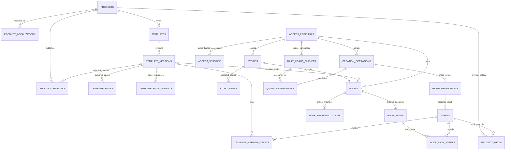

# Proposed product database schema - Phase A

Status: **design for approval, not implemented** (2026-11-05). SQLAlchemy async, asyncpg and Alembic remain the chosen infrastructure. Only revision `0001` and `stories` / `story_pages` exist today. See [ARCHITECTURE.md](ARCHITECTURE.md) for service/module responsibilities and [API_CONTRACTS.md](API_CONTRACTS.md) for DTOs.

Revision note: the common Book architecture is accepted in principle, but Phase B remains on hold. Anonymous owner/session and capability-quota tables below are proposed additions, not existing database objects. Registration is optional; ownership enforcement is not.

## Preserve the accepted foundation

Keep `stories` as the AI generation ledger with its existing pending/processing/completed/failed states, minimized child/request metadata, schema/policy versions, approved content header, safe usage metadata and error code. Keep `story_pages` as the immutable accepted AI source pages. Do not rename these tables into generic Books or relax their completed-content invariant. Their existing UUIDs, deterministic order and repository API remain valid. Source failures never acquire a Book projection or saved draft content.

New `books` / `book_pages` serve all three modes, and AI Books reference `stories.id`. This additive extension avoids stuffing template/manual lifecycle into generation status or losing original approved content when a customer edits. AI text duplication between immutable source and editable Book projection is intentional; access and retention apply to both. A source story yields at most one initial Book in this phase. Cloning/forking finalized Books is a future explicit operation.

## ERD

All new IDs are UUIDs. Audit timestamps are UTC `timestamptz`; mutable aggregates also have `updated_at` and positive bigint `revision`. Publication/finalization times are nullable until the transition. SQL checks guard enums, positivity, timestamp/state coherence and valid JSON top-level versions. Strict domain models validate JSON contents; no database-wide claim of JSON semantic/quality validation. Language codes initially en/he, direction rtl/ltr derived by the existing reviewed language support, not guessed from content. Localized text uses Unicode; no transliteration or string reversal.

## Catalog and authored content tables

| Table | Columns and key constraints |
| --- | --- |
| `products` | id PK; slug unique lowercase stable ASCII identifier; category_key; status draft/published/retired; visibility public/unlisted/hidden; recommended_min_age_months >=0 and nullable inclusive max >=min; created_at/updated_at; revision. Age is discovery guidance, not a Book page-count rule. Slug changes need redirects later; do not recycle existing slugs. |
| `product_localizations` | PK(product_id, language), product FK; localized title and description; audit timestamps. Missing locale is not silently translated. Product localized descriptions are plain text. |
| `templates` | id PK; product_id FK RESTRICT; stable key unique per product; created_at; UNIQUE(id, product_id) for composite references. A product may offer multiple authored families. |
| `template_versions` | id PK; template_id, product_id (integrity-only denormalization), language; revision_number >0; state draft/published/retired; schema_version; renderer_version; layout_registry_version; policy_version; personalization_schema JSONB; authored book metadata JSONB; draft_revision for author concurrency; created_at/updated_at/published_at; seal digest over the aggregate. UNIQUE(template_id,language,revision_number); FK(template_id,product_id) -> templates(id,product_id); UNIQUE(id,product_id,language). |
| `template_pages` | id PK; template_version_id FK; page_key unique within version; document_schema_version; typed TemplateDocument JSONB. Page sequence belongs to a variant, not this table's physical order. |
| `template_page_variants` | PK(template_version_id, variant_key); label localization JSONB; ordered_page_keys JSONB string array; page_count >0. JSON is a bounded typed list validated to have existing unique page keys and exact count on publication; it cannot reference another version. One variant means fixed length; multiple finite sequences mean configurable length. No arbitrary expressions. |
| `template_version_assets` | PK(template_version_id,slot_key,option_key); asset_id FK RESTRICT. option_key is a stable declared choice ID or the reserved literal default. Includes all media variants needed to render the sealed release. |
| `product_releases` | PK(product_id,language); template_version_id; composite FK(template_version_id,product_id,language) -> template_versions(id,product_id,language). Chooses the current published, matching-language release. Version state/public eligibility is checked under publication locks; changing pointer affects only future Books. |
| `product_media` | id PK; product_id/language; asset_id FK RESTRICT; role cover/preview; ordinal >=1; UNIQUE(product_id,language,role,ordinal); localized alt text. References only cleared public editorial assets and synthetic sample imagery, never a private book or personalized preview. |

The typed personalization schema stores per-field localization, defaults and constraints in one version-sealed document so validation rules cannot drift across independently mutable rows. It is not an uncontrolled general JSON extension. Catalog category keys are a small configured taxonomy in this phase, not a commerce taxonomy service. Every publicly discoverable language needs localized product metadata, a published release and cleared public sample media.

Publication transaction locks product and draft version, validates the full aggregate (locale completeness, variant/page references, field/default/option types, every field reference, all image slots, assets ready/public and renderer/layout support), seals it, then updates the release pointer. A draft version may change under optimistic revision control. Publishing freezes every content column and child row. Proposed PostgreSQL triggers lock the parent template version before any child mutation and reject changes to sealed content; retirement may change state/retired_at only. This prevents publication/child-edit races, including direct SQL. Published/retired content cannot be deleted while referenced. Only a tightly scoped authoring role may execute publication operations; no public authoring/admin routes are proposed.

## Individual books and assets

| Table | Columns and key constraints |
| --- | --- |
| `books` | id PK; creation_mode AI_GENERATED/TEMPLATE_BASED/MANUAL; state draft/finalized/archived; language/direction; title; document_schema_version; revision >=1; source_story_id nullable UNIQUE FK stories RESTRICT; source_template_version_id nullable FK template_versions RESTRICT; source_variant_key nullable; source_snapshot JSONB typed immutable display/version metadata; created_at/updated_at/finalized_at/archived_at. CHECK exactly the mode-appropriate source: AI story only, template version+variant only, manual neither. Composite FK(version,variant) -> template_page_variants. Product comes from version; do not introduce a conflicting independent product_id. |
| `book_personalizations` | book_id PK/FK CASCADE; schema_version; source_template_version_id FK; resolved_values JSONB; schema_digest; created_at. Required for TEMPLATE_BASED only; source must equal book source. Values are validated against the pinned schema, defaults resolved and stored once. No redundant full child profile. Cross-table coherence enforced by aggregate service/deferred constraint trigger before commit. |
| `book_pages` | id PK (stable editor identity); book_id FK CASCADE; position >=1; document_schema_version; typed PageDocument JSONB; nullable source_page_key and source_target_id; created_at/updated_at. UNIQUE(book_id,position) DEFERRABLE INITIALLY IMMEDIATE; UNIQUE(book_id,id) for asset binding. Source IDs remain opaque strings because existing StoryV2 IDs are not UUIDs. |
| `book_page_assets` | book_id, page_id, slot_key composite PK; FK(book_id,page_id) -> book_pages(book_id,id) CASCADE; asset_id FK RESTRICT; optional bounded crop/fit metadata in typed document, not a second media URL. Exactly matches image slots in the page document. All assets must be ready and accessible to the Book's actor/scope. |
| `assets` | id PK; storage_backend enum configured at deployment; object_key unique per backend; immutable checksum; media_type allowlist; byte_size >0; dimensions >0 when relevant; scope public_editorial/private; state pending/ready/blocked; created_at. No image bytes, arbitrary URLs, access tokens, filenames containing child names or signed URLs are persisted. Ready asset content is immutable; new bytes mean a new ID. |

Public template references require public editorial assets. Private asset authorization is enforced at each assignment/read; storage object paths are never accepted from clients. Upload/scanning/signing systems are external future adapters; initial fixtures use only developer-provisioned safe assets. Do not make arbitrary remote fetches. Source product/template/version and chosen display options are snapshotted sufficiently to reopen the exact rendered book, even when the catalog release changes. Source assets cannot be overwritten or hard-deleted while referenced. Retirement hides future creation but does not automatically erase existing private Books; security blocking of an asset overrides delivery and is distinct from catalog retirement.

`source_snapshot` is a strict creation-mode union, not arbitrary extension JSON: AI stores original schema/profile/policy/check versions, resolved constraints and initial Book revision; template stores localized product display title, pinned version/variant, schema digest and renderer/layout versions; manual stores only document/policy version. No second copy of child age, guidance or the full request is added. AI Book insertion additionally requires its source story to be completed, checked in the shared transaction and deferred source-coherence constraint. Source quality applies only to the initial source revision. Rendered BookPages remain authoritative for reopening edited books.

## Lifecycles, transactions, concurrency and deletion

- Template instantiation: capture a published version under lock, validate choices, render purely outside a long transaction, then recheck release eligibility and insert Book+Personalization+all pages+bindings atomically. Pin the version explicitly; never silently substitute a newer release. Preview uses the same renderer but saves nothing.
- AI: create/start existing story in short transactions, execute engine with no open DB transaction, then complete source and create its Book projection in **one shared unit of work**. Refactor repository internals to offer transaction-aware helpers, preserving existing standalone method behavior/tests; never nest independently committed repository calls. A failed/partial/rejected result saves only terminal safe generation metadata, no Book. New v3 calls can return a story ID for a failed attempt.
- Editing: lock the parent Book, require draft and matching revision, apply a single atomic command, validate the whole resulting document, then increment revision once. Even a page-only change increments Book revision. Reorder requires an exact permutation of all current page UUIDs; defer the named position constraint inside that transaction to avoid swap collisions. Add/delete renumbers contiguously before commit. Drafts may have zero pages; finalized books require >=1 and configured policy limits. Page count returned to clients is derived, not a stale stored counter.
- Finalization: compare revision and validate all pages/asset bindings/content-policy rules, then transition once. No edits to finalized/archived Books; any future fork must allocate a new Book identity and explicit origin. Proposed Book child triggers serialize on the parent and reject direct writes to non-drafts; transition service/constraint trigger verifies contiguity, minimum count and personalization/source coherence at commit. Pure JSON/document semantics remain application validation.
- Reads: revision/header/pages use the existing shared parent-row-lock pattern (short transaction); cursor list ordering is `(created_at DESC,id DESC)`. Writes share that parent lock. Lock ordering: product/version for authoring; source story then Book for AI; Book then pages/assets for edits. Configure bounded statement/lock timeouts and sanitize deadlock/timeout errors; never rerun generation automatically.
- Archive is not erasure. A future authorized deletion use case must remove private pages/bindings/choice snapshots and its linked source generation together under a retention policy; RESTRICT means deletion order is deliberate. Historical source without a Book also needs retention. No public delete, purge job, user audit feed or personal-data event log is invented here.

Unit-of-work port: `async with uow_factory() as uow` exposes transaction-bound story/book/template/asset repository ports; application code uses typed domain arguments, never SQLAlchemy sessions. A normal successful exit commits once, an exception/cancellation rolls back. Existing `SqlAlchemyStoryRepository.complete` keeps its standalone signature and delegates to an internal `_complete_in_transaction(session, ...)`; the unit-of-work adapter binds the same helper to its session, together with Book insertion. It must not call the standalone auto-committing wrapper inside the shared transaction. Test both paths, including a Book-page insertion failure after source completion staging.

Indexes: retain story status index. Add products(status,visibility,created_at,id), product_localizations(language,product_id), template_versions(template_id,language,state,revision_number), product_media(product_id,language,role,ordinal), books(owner_principal_id,created_at DESC,id DESC), books(owner_principal_id,state,created_at DESC,id DESC), books(source_template_version_id), template_version_assets(asset_id), book_page_assets(asset_id). PK/unique indexes cover page order, release lookup and source story lookup. Index all additional FK columns used for joins/deletion, including source-story/private-asset principal IDs. Do not add broad GIN indexes on children's text or personalization. Private library indexes/queries are owner-leading from first anonymous rollout, not deferred until registration.

## Anonymous access, ownership and usage schema delta

| Proposed table/change | Keys, minimal fields and invariants |
| --- | --- |
| `access_principals` | id UUID PK; kind anonymous/account; status active/claimed/revoked; nullable claimed_by_principal_id FK RESTRICT; created_at/expires_at. Only anonymous may point to an active account principal; no chains/cycles/self-link. A claim is one-way and uniquely audit-recorded. No child names, email/passwords or inferred identities. Account principals are allocated only from a future verified identity adapter, not client owner IDs. |
| `access_sessions` | id UUID PK; principal_id FK; token_digest unique; digest_key_version; csrf_digest; csrf_nonce (non-secret random salt) and csrf_key_version; created_at/last_seen_at/idle_expires_at/absolute_expires_at/revoked_at. Raw bearer/CSRF tokens never stored. Derive the returned CSRF token with a separate server HMAC key over session ID/nonce/credential version so GET session can reproduce it without storing plaintext; verify the session-bound token in constant time. Rotate credentials/CSRF context while keeping principal identity; absolute expiry cannot extend through rotation. Index token_digest, principal_id and expiry cleanup. Key material stays in secret configuration, not rows. |
| `principal_claims` | anonymous_principal_id PK/FK; account_principal_id FK; claimed_at; claim_operation_id unique. Only the verified account plus fresh anonymous proof may authorize; double claim to another account fails. Existing ownership references remain to the claimed namespace, which is now accessible only through that account. Minimal audit contains IDs/outcome, not credentials or child data. Future verified subject-to-account mapping is owned by the auth adapter, not a speculative users table here. |
| Owner columns | Add owner_principal_id FK RESTRICT to Book, source stories, private assets and creation operations. Book pages/personalization inherit Book ownership. Editorial public assets use NULL owner with scope check; private assets require owner. Old 0001 stories remain NULL-owned/quarantined and inaccessible to new anonymous APIs; never grant to first reader. New public-entry writes require an actual principal. Verify linked Book/source/operation/private-asset authorization using the canonical account-plus-claimed namespace scope. |
| `creation_operations` | id UUID PK; owner_principal_id FK (issuance namespace); capability story_generation/image_generation; idempotency_key_digest; request_fingerprint HMAC and key version; admitted_schema_version/execution_policy_version; frozen configuration reference/digest; request_id; admission_day date; created_at/updated_at; dispatch_authorized_at nullable; terminal_outcome nullable fixed enum; source_story_id nullable unique FK; idempotency_expires_at. UNIQUE(owner_principal_id,capability,idempotency_key_digest); capability/source shape checks. No raw payload, prompts, provider messages or tokens. Execution/job states, encrypted request-envelope storage and leases await Agent 1's design; do not create competing job ledgers. |
| `daily_usage_buckets` | PK(namespace_principal_id,capability,utc_day); principal FK; reserved_count >=0; consumed_count >=0; policy_version; updated_at. Capacity is 10 separately per capability over the canonical owner's namespaces. Do not CHECK combined usage <=10: claiming previously independent namespaces can legitimately produce an inherited total >10, with remaining clamped to zero. New admission still requires effective used+reserved <10. No general writable counter endpoint. |
| `quota_reservations` | operation_id PK/FK RESTRICT; bucket namespace/capability/day composite FK; units CHECK=1; state reserved/consumed/released; created_at/settled_at; release_reason fixed nullable enum. One row per operation. Match operation owner/capability/admission_day through composite keys/deferred coherence constraint. Reserved -> consumed or released exactly once; retries never allocate a second row. Released operation is fenced from later provider dispatch. |
| `image_generations` | id UUID PK; operation_id unique FK; owner_principal_id FK; pending/processing/completed/failed; schema/policy versions; safe allowlisted generation metadata; nullable fixed failure_code; nullable accepted_asset_id unique FK RESTRICT. Completed requires a ready private accepted asset; failed/rejected results cannot reference deliverable media. Validate owner/capability/result linkage in service/deferred constraints. One operation generates at most one image; no batch-count ambiguity. Provider/model implementations are outside this revision. |

An image quota does not authorize attachment to an arbitrary Book/page. Assignment still requires access to both resources and Book If-Match. Blocking/revoking a generated image prevents delivery even if its operation completed. Rejected provider imagery must never become a ready/private-deliverable Asset; temporary provider buffers have separate disposal rules. Byte limits/content checks and provider-specific safety remain Agent 1/image-service dependencies.

### Transaction algorithm, day boundary and accounting

1. Validate body, language/schema/capability support, session/CSRF and pre-provider policy. Apply independent abuse throttles. Resolve canonical account/anonymous scope; acquire that principal's row lock, recheck claim/status after the lock, and restart if it changed. Claim acquires its two principal gates in UUID order; normal admission never locks a second principal while holding a stale first one. Settlement/release must resolve the same canonical gate, including a claim occurring during execution.
2. Inside the short transaction, capture one database `clock_timestamp()` after admission-gate acquisition and derive `(timestamp AT TIME ZONE 'UTC')::date`. Use it for quota day/reset_at. Request-arrival time, browser timezone and application-host clocks are not authoritative. The counter is chosen at admission, not completion; no reset/delete-at-midnight job. A request admitted just before UTC midnight remains charged to that date, including a queued job or provider response after midnight. A retry of its idempotency key keeps the original operation/date.
3. Check idempotency across authorized issuance namespaces before consuming another unit. Same key+capability+fingerprint replays that operation; changed payload (or ambiguous alias collision) returns 409. Account claim does not rewrite keys or erase old operations. Fingerprints are keyed HMACs over the canonical validated **client request**, not stored raw child input or unkeyed guessable hashes. Freeze resolved server/profile/prompt/schema/pricing configuration separately on first admission, following Agent 1's integration proposal `e34b588`; changed server defaults must not change replay identity. Any future explicit client policy/version selector would be part of its client request fingerprint. Existing-key replay uses the original retained interpretation/snapshot contract before new-policy admission checks; deploying a new policy must not turn an old retry into fresh work. Proposed retention: at least pending lifetime and 48 hours after terminal outcome, subject to retention approval. After expiry, frontend must not retry as if deduplication were guaranteed.
4. Sum reserved_count+consumed_count for the effective owner's own and claimed namespaces for this capability/date. Alias membership cannot change while its gate is held. If >=10, deny with 429 and no provider dispatch. Otherwise create bucket if missing (`INSERT ... ON CONFLICT DO NOTHING`), increment reserved_count and insert operation+reservation/source pending record atomically; rollback removes all of them. If Agent 1 chooses a durable outbox, enqueue in the same transaction. Unique keys and the principal gate serialize requests across all pods, including first-bucket creation. A conditional bucket update is an extra guard, not a replacement for alias-wide admission checking.
5. Just before the first possibly billable provider dispatch, atomically mark the operation authorized and reservation consumed: reserved_count--, consumed_count++, conditional on reserved and a valid execution lease/fence. Commit before sending, with no database transaction held over the call. Subsequent permitted attempts/recovery within this same operation do not increment counters; never start a second independent engine run under the original unit without Agent 1's recovery approval. Unknown send status keeps consumed. A provider rejection/timeout/quality failure still counts and never stores rejected content.
6. A proven pre-dispatch failure/cancel condition may atomically change reserved -> released and decrement reserved_count once under the canonical gate, while cancelling/fencing dispatch. Never release solely because a TTL elapsed or a worker stopped heartbeating; a stale worker must be unable to send after release. Cancellation after authorization does not refund automatically. Settlement is idempotent; duplicate callbacks cannot decrement twice. Source/Book rollback does not undo a unit already consumed before dispatch.

Database-local gates and uniqueness, rather than a read-then-write in application memory, enforce concurrency. PostgreSQL documents [ON CONFLICT behavior](https://www.postgresql.org/docs/17/sql-insert.html) and [transaction versus actual wall-clock timestamps](https://www.postgresql.org/docs/17/functions-datetime.html); this proposed algorithm additionally relies on explicit principal locking and scope rechecks. No test of the new algorithm is claimed.

Claim transaction locks anonymous/account gates in UUID order, verifies both proofs and no prior different claim, then inserts principal_claims, marks guest claimed and revokes guest sessions atomically. No bulk content/asset owner rewrite or new allowance is granted. Effective account usage is the sum of its existing buckets and newly linked guest buckets; it may be >10 and all reservations remain valid. Active workers settle their original bucket via the now-canonical gate. Old guest credentials may neither read results nor admit new work. Concurrent claims/admissions/releases require real PostgreSQL tests with held locks; account principal creation/verified-login session issuance is a future auth contract.

Resource reads/delivery revalidate the session under a short shared principal gate before reading scoped content; claim/revocation uses the exclusive gate. An already delivered response cannot be recalled, but stale credentials must not mint new delivery grants after claim commits. Prefer an authorization-checking media gateway (or revocation-epoch-checked token) for private results; bare long-lived object-store presigned URLs do not provide immediate claim/revocation enforcement. Global transaction lock order is canonical principal -> operation/reservation -> quota buckets in deterministic key order -> source story -> Book -> pages/asset bindings; acquire this outer gate before existing source/Book locks. Authoring uses its separate product/version order. Gate-protected claim invalidates old scope and forces a retry before any new read/admission, not a lock upgrade from guest to account while holding the old gate.

Add indexes on claimed_by_principal_id, principal_claims(account_principal_id), operations(owner_principal_id,created_at,id), operations(idempotency_expires_at), session expiry, and reservation state/bucket. Preserve reservations at least while operations can execute/settle/replay. Retention cleanup must not delete active quota evidence or make a same-day reset by deleting a principal; revocation blocks new use without clearing counters. Abuse/network digest state is short-lived and access-restricted; choose a separate rate-limiter adapter with shared state before multi-instance rollout. Redis may accelerate abuse controls but is not daily quota authority. Multiple regions require one writer/consistent routing per canonical scope; fail closed on quota-store unavailability or uncertain admission commit, and recover by idempotency lookup rather than dispatching speculatively.

## Migration sequence and rollback proposal

All identifiers below are reserved design labels, **no migration files exist beyond 0001**.

1. `0002_catalog_templates_assets`: additive catalog/localization/assets/template tables, FK/indexes and sealed-version triggers. No proprietary fixtures. Downgrade drops only these new tables in dependency order, and must refuse while referenced by later Book tables.
2. `0003_books_documents`: additive Book/choice/page/binding tables, checks, revision/lifecycle triggers and constraints. No stories rename/data deletion. Deployment remains gated; upgrade and standalone downgrade tests run on disposable PostgreSQL.
3. `0004_access_principals_sessions` (new proposal): principal/session/claim records and owner FKs/indexes on Book/stories/private assets. Keep legacy ownerless records quarantined; do not invent user ownership or alter 0001's source-content checks. Backfill ownership only with verified provenance. Anonymous public-entry features stay disabled until mandatory scoping and session/CSRF/retention tests pass. Rollback requires disabling access and preserving/revoking all live sessions; do not orphan private records or expose them globally.
4. `0005_capability_admission` (new proposal, coordinate with Agent 1): operations, daily buckets, reservations and image source/result references, with dispatch/settlement constraints. Exact migration split/IDs depend on Agent 1's execution/outbox design; no independent duplicate operations schema. Downgrade must stop admissions/workers, resolve active work and preserve accounting evidence before dropping state; never erase same-day counters to re-enable spending.
5. Explicit optional backfill command, not an unbounded Alembic side effect: read only completed source stories, reconstruct/validate stored StoryV2 shape, allocate one AI Book via unique source_story_id, copy pages deterministically in per-book transactions and report counts/IDs only. Idempotent rerun skips existing projections. Existing 0001 rows do not retain full resolved constraints/profile snapshots: do not pretend to rerun historical contextual quality against current profiles. Require recognizable source schema/policy/profile versions and recorded completion provenance; quarantine unsupported/missing evidence for review, or import only as an unverified private draft with explicit approval. Reject invalid legacy rows with fixed codes; never promote pending/failed/rejected sources. Keep backups and an operator manifest of created projection IDs for reversible review. Original rows/UUIDs remain untouched. Backfill choice requires approval.

Before rollback: disable new routes/writes/workers, back up private data and accounting/access state; dropping Book tables destroys manual/template customer work and cannot be reconstructed from AI stories. No automatic rollback is safe after production use. Reverse dependents 0005 -> 0004 -> 0003 -> 0002, preserving 0001 and quarantining records whose owner scope cannot be retained. PostgreSQL triggers/deferrable constraints require real runtime tests; SQLite cannot prove them. Migration lock time and volume need rehearsal on representative synthetic data. No production deployment or data migration is authorized by Phase A.

## Ownership and unresolved policy

No session/identity/quota schema exists today. The revised product target supports anonymous creation and private ownership immediately upon a future secure rollout; it does not wait for account registration. Implement the principal/session/owner boundary first, then expose only session-scoped private APIs. Current code remains synthetic-local-only until that future implementation is authorized and verified. Public catalog has no private projection. All-owner library queries, UUID-based claims and ownerless legacy resource delivery are prohibited. Future account linking requires a genuine verified identity adapter, not invented user IDs. Expiry, orphan cleanup, deletion of linked source/assets and data-retention periods require approval before real-child-data rollout.

Open approval decisions: UTC day boundary and count-at-dispatch/failure policy; session idle/absolute TTL and claim proof window; operation/idempotency retention and optional temporary raster-preview TTL; adaptive-abuse thresholds and privacy tradeoffs; Agent 1 execution/lease/outbox and image-safety contracts; editor/schema/body limits; publication permissions; finalization/forks; linked-data retention/deletion; media rights; legacy backfill opt-in. Ten units per AI capability is fixed by the product requirement, not a limit the client or templates can raise. No commerce tables are introduced.
