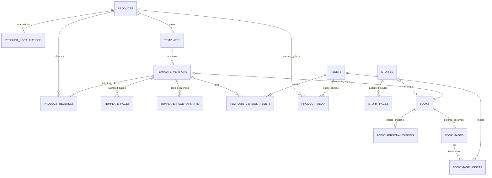

# Proposed product database schema - Phase A

Status: **design for approval, not implemented** (2026-11-05). SQLAlchemy async, asyncpg and Alembic remain the chosen infrastructure. Only revision `0001` and `stories` / `story_pages` exist today. See [ARCHITECTURE.md](ARCHITECTURE.md) for service/module responsibilities and [API_CONTRACTS.md](API_CONTRACTS.md) for DTOs.

## Preserve the accepted foundation

Keep `stories` as the AI generation ledger with its existing pending/processing/completed/failed states, minimized child/request metadata, schema/policy versions, approved content header, safe usage metadata and error code. Keep `story_pages` as the immutable accepted AI source pages. Do not rename these tables into generic Books or relax their completed-content invariant. Their existing UUIDs, deterministic order and repository API remain valid. Source failures never acquire a Book projection or saved draft content.

New `books` / `book_pages` serve all three modes, and AI Books reference `stories.id`. This additive extension avoids stuffing template/manual lifecycle into generation status or losing original approved content when a customer edits. AI text duplication between immutable source and editable Book projection is intentional; access and retention apply to both. A source story yields at most one initial Book in this phase. Cloning/forking finalized Books is a future explicit operation.

## ERD

All new IDs are UUIDs. Audit timestamps are UTC `timestamptz`; mutable aggregates also have `updated_at` and positive bigint `revision`. Publication/finalization times are nullable until the transition. SQL checks guard enums, positivity, timestamp/state coherence and valid JSON top-level versions. Strict domain models validate JSON contents; no database-wide claim of JSON semantic/quality validation. Language codes initially en/he, direction rtl/ltr derived by the existing reviewed language support, not guessed from content. Localized text uses Unicode; no transliteration or string reversal.

## Catalog and authored content tables

| Table | Columns and key constraints |
| --- | --- |
| `products` | id PK; slug unique lowercase stable ASCII identifier; category_key; status draft/published/retired; visibility public/unlisted/hidden; recommended_min_age_months >=0 and nullable inclusive max >=min; created_at/updated_at; revision. Age is discovery guidance, not a Book page-count rule. Slug changes need redirects later; do not recycle existing slugs. |
| `product_localizations` | PK(product_id, language), product FK; localized title and description; audit timestamps. Missing locale is not silently translated. Product localized descriptions are plain text. |
| `templates` | id PK; product_id FK RESTRICT; stable key unique per product; created_at; UNIQUE(id, product_id) for composite references. A product may offer multiple authored families. |
| `template_versions` | id PK; template_id, product_id (integrity-only denormalization), language; revision_number >0; state draft/published/retired; schema_version; renderer_version; layout_registry_version; policy_version; personalization_schema JSONB; authored book metadata JSONB; draft_revision for author concurrency; created_at/updated_at/published_at; seal digest over the aggregate. UNIQUE(template_id,language,revision_number); FK(template_id,product_id) -> templates(id,product_id); UNIQUE(id,product_id,language). |
| `template_pages` | id PK; template_version_id FK; page_key unique within version; document_schema_version; typed TemplateDocument JSONB. Page sequence belongs to a variant, not this table's physical order. |
| `template_page_variants` | PK(template_version_id, variant_key); label localization JSONB; ordered_page_keys JSONB string array; page_count >0. JSON is a bounded typed list validated to have existing unique page keys and exact count on publication; it cannot reference another version. One variant means fixed length; multiple finite sequences mean configurable length. No arbitrary expressions. |
| `template_version_assets` | PK(template_version_id,slot_key,option_key); asset_id FK RESTRICT. option_key is a stable declared choice ID or the reserved literal default. Includes all media variants needed to render the sealed release. |
| `product_releases` | PK(product_id,language); template_version_id; composite FK(template_version_id,product_id,language) -> template_versions(id,product_id,language). Chooses the current published, matching-language release. Version state/public eligibility is checked under publication locks; changing pointer affects only future Books. |
| `product_media` | id PK; product_id/language; asset_id FK RESTRICT; role cover/preview; ordinal >=1; UNIQUE(product_id,language,role,ordinal); localized alt text. References only cleared public editorial assets and synthetic sample imagery, never a private book or personalized preview. |

The typed personalization schema stores per-field localization, defaults and constraints in one version-sealed document so validation rules cannot drift across independently mutable rows. It is not an uncontrolled general JSON extension. Catalog category keys are a small configured taxonomy in this phase, not a commerce taxonomy service. Every publicly discoverable language needs localized product metadata, a published release and cleared public sample media.

Publication transaction locks product and draft version, validates the full aggregate (locale completeness, variant/page references, field/default/option types, every field reference, all image slots, assets ready/public and renderer/layout support), seals it, then updates the release pointer. A draft version may change under optimistic revision control. Publishing freezes every content column and child row. Proposed PostgreSQL triggers lock the parent template version before any child mutation and reject changes to sealed content; retirement may change state/retired_at only. This prevents publication/child-edit races, including direct SQL. Published/retired content cannot be deleted while referenced. Only a tightly scoped authoring role may execute publication operations; no public authoring/admin routes are proposed.

## Individual books and assets

| Table | Columns and key constraints |
| --- | --- |
| `books` | id PK; creation_mode AI_GENERATED/TEMPLATE_BASED/MANUAL; state draft/finalized/archived; language/direction; title; document_schema_version; revision >=1; source_story_id nullable UNIQUE FK stories RESTRICT; source_template_version_id nullable FK template_versions RESTRICT; source_variant_key nullable; source_snapshot JSONB typed immutable display/version metadata; created_at/updated_at/finalized_at/archived_at. CHECK exactly the mode-appropriate source: AI story only, template version+variant only, manual neither. Composite FK(version,variant) -> template_page_variants. Product comes from version; do not introduce a conflicting independent product_id. |
| `book_personalizations` | book_id PK/FK CASCADE; schema_version; source_template_version_id FK; resolved_values JSONB; schema_digest; created_at. Required for TEMPLATE_BASED only; source must equal book source. Values are validated against the pinned schema, defaults resolved and stored once. No redundant full child profile. Cross-table coherence enforced by aggregate service/deferred constraint trigger before commit. |
| `book_pages` | id PK (stable editor identity); book_id FK CASCADE; position >=1; document_schema_version; typed PageDocument JSONB; nullable source_page_key and source_target_id; created_at/updated_at. UNIQUE(book_id,position) DEFERRABLE INITIALLY IMMEDIATE; UNIQUE(book_id,id) for asset binding. Source IDs remain opaque strings because existing StoryV2 IDs are not UUIDs. |
| `book_page_assets` | book_id, page_id, slot_key composite PK; FK(book_id,page_id) -> book_pages(book_id,id) CASCADE; asset_id FK RESTRICT; optional bounded crop/fit metadata in typed document, not a second media URL. Exactly matches image slots in the page document. All assets must be ready and accessible to the Book's actor/scope. |
| `assets` | id PK; storage_backend enum configured at deployment; object_key unique per backend; immutable checksum; media_type allowlist; byte_size >0; dimensions >0 when relevant; scope public_editorial/private; state pending/ready/blocked; created_at. No image bytes, arbitrary URLs, access tokens, filenames containing child names or signed URLs are persisted. Ready asset content is immutable; new bytes mean a new ID. |

Public template references require public editorial assets. Private asset authorization is enforced at each assignment/read; storage object paths are never accepted from clients. Upload/scanning/signing systems are external future adapters; initial fixtures use only developer-provisioned safe assets. Do not make arbitrary remote fetches. Source product/template/version and chosen display options are snapshotted sufficiently to reopen the exact rendered book, even when the catalog release changes. Source assets cannot be overwritten or hard-deleted while referenced. Retirement hides future creation but does not automatically erase existing private Books; security blocking of an asset overrides delivery and is distinct from catalog retirement.

`source_snapshot` is a strict creation-mode union, not arbitrary extension JSON: AI stores original schema/profile/policy/check versions, resolved constraints and initial Book revision; template stores localized product display title, pinned version/variant, schema digest and renderer/layout versions; manual stores only document/policy version. No second copy of child age, guidance or the full request is added. AI Book insertion additionally requires its source story to be completed, checked in the shared transaction and deferred source-coherence constraint. Source quality applies only to the initial source revision. Rendered BookPages remain authoritative for reopening edited books.

## Lifecycles, transactions, concurrency and deletion

- Template instantiation: capture a published version under lock, validate choices, render purely outside a long transaction, then recheck release eligibility and insert Book+Personalization+all pages+bindings atomically. Pin the version explicitly; never silently substitute a newer release. Preview uses the same renderer but saves nothing.
- AI: create/start existing story in short transactions, execute engine with no open DB transaction, then complete source and create its Book projection in **one shared unit of work**. Refactor repository internals to offer transaction-aware helpers, preserving existing standalone method behavior/tests; never nest independently committed repository calls. A failed/partial/rejected result saves only terminal safe generation metadata, no Book. New v3 calls can return a story ID for a failed attempt.
- Editing: lock the parent Book, require draft and matching revision, apply a single atomic command, validate the whole resulting document, then increment revision once. Even a page-only change increments Book revision. Reorder requires an exact permutation of all current page UUIDs; defer the named position constraint inside that transaction to avoid swap collisions. Add/delete renumbers contiguously before commit. Drafts may have zero pages; finalized books require >=1 and configured policy limits. Page count returned to clients is derived, not a stale stored counter.
- Finalization: compare revision and validate all pages/asset bindings/content-policy rules, then transition once. No edits to finalized/archived Books; any future fork must allocate a new Book identity and explicit origin. Proposed Book child triggers serialize on the parent and reject direct writes to non-drafts; transition service/constraint trigger verifies contiguity, minimum count and personalization/source coherence at commit. Pure JSON/document semantics remain application validation.
- Reads: revision/header/pages use the existing shared parent-row-lock pattern (short transaction); cursor list ordering is `(created_at DESC,id DESC)`. Writes share that parent lock. Lock ordering: product/version for authoring; source story then Book for AI; Book then pages/assets for edits. Configure bounded statement/lock timeouts and sanitize deadlock/timeout errors; never rerun generation automatically.
- Archive is not erasure. A future authorized deletion use case must remove private pages/bindings/choice snapshots and its linked source generation together under a retention policy; RESTRICT means deletion order is deliberate. Historical source without a Book also needs retention. No public delete, purge job, user audit feed or personal-data event log is invented here.

Unit-of-work port: `async with uow_factory() as uow` exposes transaction-bound story/book/template/asset repository ports; application code uses typed domain arguments, never SQLAlchemy sessions. A normal successful exit commits once, an exception/cancellation rolls back. Existing `SqlAlchemyStoryRepository.complete` keeps its standalone signature and delegates to an internal `_complete_in_transaction(session, ...)`; the unit-of-work adapter binds the same helper to its session, together with Book insertion. It must not call the standalone auto-committing wrapper inside the shared transaction. Test both paths, including a Book-page insertion failure after source completion staging.

Indexes: retain story status index. Add products(status,visibility,created_at,id), product_localizations(language,product_id), template_versions(template_id,language,state,revision_number), product_media(product_id,language,role,ordinal), books(created_at DESC,id DESC), books(state,created_at DESC,id DESC), books(source_template_version_id), template_version_assets(asset_id), book_page_assets(asset_id). PK/unique indexes cover page order, release lookup and source story lookup. Index all additional FK columns used for joins/deletion. Do not add broad GIN indexes on children's text or personalization. Add owner-leading indexes only with a real ownership model.

## Migration sequence and rollback proposal

All identifiers below are reserved design labels, **no migration files exist beyond 0001**.

1. `0002_catalog_templates_assets`: additive catalog/localization/assets/template tables, FK/indexes and sealed-version triggers. No proprietary fixtures. Downgrade drops only these new tables in dependency order, and must refuse while referenced by later Book tables.
2. `0003_books_documents`: additive Book/choice/page/binding tables, checks, revision/lifecycle triggers and constraints. No stories rename/data deletion. Deployment remains gated; upgrade and standalone downgrade tests run on disposable PostgreSQL.
3. Explicit optional backfill command, not an unbounded Alembic side effect: read only completed source stories, reconstruct/validate stored StoryV2 shape, allocate one AI Book via unique source_story_id, copy pages deterministically in per-book transactions and report counts/IDs only. Idempotent rerun skips existing projections. Existing 0001 rows do not retain full resolved constraints/profile snapshots: do not pretend to rerun historical contextual quality against current profiles. Require recognizable source schema/policy/profile versions and recorded completion provenance; quarantine unsupported/missing evidence for review, or import only as an unverified private draft with explicit approval. Reject invalid legacy rows with fixed codes; never promote pending/failed/rejected sources. Keep backups and an operator manifest of created projection IDs for reversible review. Original rows/UUIDs remain untouched. Backfill choice requires approval.

Before rollback: disable new routes/writes, back up all new private data and any dependent references; dropping Book tables destroys manual/template customer work and cannot be reconstructed from AI stories. No automatic rollback is safe after production use. Roll back 0003 before 0002, preserve 0001. PostgreSQL triggers/deferrable constraints require real runtime tests; SQLite cannot prove them. Migration lock time and volume need rehearsal on representative synthetic data. No production deployment or data migration is authorized by Phase A.

## Ownership and unresolved policy

No users/identities exist. New private APIs are disabled by default and available only in an explicit loopback, synthetic-data-only local mode; never infer ownership from UUIDs, request-supplied user headers or CORS. Public catalog has no private projection. Before production, choose an authenticated principal model, add a real owner FK for Books/private assets/generation source scope, backfill or quarantine null-owned legacy records, add owner-leading indexes and enforce owner predicates in every repository. Do not expose all-owner list queries. Public registration/account tables and auth implementation are outside the approved foundation.

Open approval decisions: editor/preview body and block/page limits; template publication permissions; whether finalized Books may later fork; retention and linked-source deletion; local access composition and eventual owner model; media adapter/rights review; exact backfill opt-in. Template/manual content safety and human editorial approval are separate from the existing AI gate. Future commerce references finalized Book IDs; no speculative order/payment/pricing tables now.
