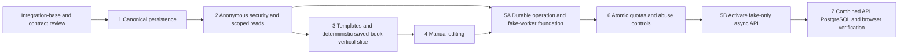

# Phase B incremental implementation plan

Status: **Milestone 1 implemented after explicit approval; milestones 2 onward remain plans requiring approval**. See current handoff for evidence and BACKEND_ROADMAP.md for the commerce extension.
Prepared 2026-11-05 from Agent 3 branch `feature/storyforge-persistence-foundation`,
commit `7e38326`, and read-only review of Agent 1's latest
`docs/AI_BACKEND_INTEGRATION_CONTRACT.md` at `49410d0`.

The seven milestones below include the eventual API integration work previously
called Phase C and final verification previously called Phase D. Naming them in
this plan does not authorize either phase or shared-route edits. Each milestone
requires its own reviewable implementation and passing relevant tests; later
dependencies cannot be replaced by permissive runtime stubs.

## Planning defaults and invariants

| Item | Baseline for this plan |
| --- | --- |
| Daily boundary | UTC calendar date, sampled from PostgreSQL after admission lock; original day retained through execution/claim |
| AI allowance | 10 story units and 10 image units independently per effective principal/claimed namespace set; no per-pod or cookie-rotation reset |
| Consumption | Reserve at acceptance; consume exactly once when first provider dispatch authorization commits durably with its attempt/token/cost journal |
| Release | Only proven failure/cancellation before committed dispatch authorization, with every potential dispatcher fenced; dispatched/uncertain work remains counted |
| Anonymous session | Latest approved design: 7-day idle plus 30-day absolute lifetime; activity/rotation cannot extend the absolute deadline |
| Idempotency | Entire nonterminal lifetime plus **at least 48 hours after terminal outcome**; retain compatible digest keys/canonicalizers; erased-result tombstones contain no child content |
| Guest preview | No registration, no saved Book/choices and no AI quota; separate rate/size/concurrency controls |
| Async story entry | Separate POST `/v3/jobs/stories`, new operation -> 202, Location `/v3/operations/{id}`, polling Retry-After; duplicate matching key -> 200 same status, not a new job |
| Engine baseline | Existing whole-book StoryV2 execution, four nodes, current three-attempt/shared budget protections; no chunking, new models, paid calls or larger limits |

Public operation states planned to align with Agent 1: queued, processing,
completed, failed, cancelled. Source stories retain pending/processing/completed/
failed; cancelled source uses failed/CANCELLED. Book lifecycle remains separate.
Same client request/key uses the original stored interpretation regardless of a
later deployment; freeze execution configuration separately from request identity.

Agent 1's other candidate defaults are **not silently adopted**: five-minute queue
TTL, 60-second lease/10-second heartbeat, 15-minute accepted-finalization window,
three storage-only transaction attempts and deletion within 60 seconds require
explicit approval and privacy/storage feasibility review before milestone 5.
The latest user instruction adopts seven-day idle plus 30-day absolute lifetime. Book/source retention is still a separate decision.

## Dependency and activation order

Milestone 5A builds/test-drives worker and persistence boundaries before milestone
6, but **no new public AI admission or real provider dispatch is enabled** until
milestone 6 supplies the real transactional quota adapter. Milestone 5B is its
explicit activation gate, not a second independent job system. This ordering
preserves the requested priorities without pretending quota-free jobs are safe.
Milestone tests start immediately; milestone 7 consolidates them rather than
postponing verification until the end.

Before future shared code work, approve an integration base and merge ownership
for Agent 1 diagnostics/contracts, this persistence branch and Agent 4 QA; include
Agent 2's client on its own approved integration path. No merges are performed
by this plan. Reconcile composition, lockfiles, safe errors and overlapping docs.
Run baseline tests on that actual integrated commit rather than summing isolated
branch results. Agent 3 owns product/access/jobs/persistence, Agent 1 engine/provider
ports, Agent 2 UI/client and Agent 4 independent QA. A contract amendment is not
authorization to modify another owner's code unilaterally.

## 1. Canonical Book/BookPage persistence

**Modules:** `domain/books.py`, `domain/documents.py`; `application/ports.py`;
`persistence/book_models.py`, minimal asset mappings, `book_repository.py` and
`unit_of_work.py`; transaction-aware helpers in the existing repository while
preserving its standalone API. Introduce a versioned canonical-capacity policy.

**Migration:** proposed `0002_canonical_books_assets`: additive books, book_pages,
book_page_assets and asset references; origin/lifecycle/revision constraints,
stable page UUIDs, deferrable unique ordering, FK/indexes and final-state guards.
Keep 0001 stories/story_pages and all UUIDs/content invariants intact. Until
catalog milestone 3 adds real template FKs, persist only AI/manual origins under
explicit checks; reserve the template branch without accepting dangling sources.
Ownerless test-stage Books remain internal; no public repository route exists.

**Endpoints:** none enabled. Prepare detached Book/PageDocument DTO mapping for
later routes, never expose SQLAlchemy models. No automatic historical backfill.

**Dependencies:** accepted 0001 foundation; review concrete page/block/string/
byte limits against StoryV2 worst-case output, not just word estimates. Asset
binary data stays outside PostgreSQL. No identity or provider integration required.

**Tests:** domain shape/Unicode/lifecycle validation; real PostgreSQL create/read,
exact page sequence/asset FK, duplicate positions/IDs, source uniqueness, shared
transaction rollback and consistent reads; upgrade/downgrade preserving 0001;
offline accepted StoryV2 -> Book projection including 27 Hebrew pages. Revalidate
source acceptance/context and canonical capacity without calling an engine.

**Acceptance:** typed immutable origin snapshot, lossless sentence-unit/target
mapping, no failed/rejected/partial source promoted; one transaction can stage
source completion+Book/pages and roll everything back on page failure. Existing
persistence tests pass unchanged. Public creation remains unavailable.

## 2. Anonymous session security and ownership

**Modules:** `domain/access.py`, `application/access.py`, `api/access_routes.py`,
`api/access_dependencies.py`, access DTOs; `persistence/access_repository.py`;
owner-scoped Book/source/asset queries and application lifespan/key injection.
Real account authentication is not implemented; define a verified-account claim
port and test it using synthetic verified principals only.

**Migration:** proposed `0003_anonymous_access_ownership`: principals/sessions/
namespace-claim records; owner FKs/indexes and scope checks. New private writes
require a real server-issued anonymous principal. Quarantine pre-existing unowned
stories/Books instead of assigning them to a first reader. Apply 7-day idle and 30-day absolute expiry,
revocation, keyed token digests and reproducible session-bound CSRF derivation.

**Endpoints:** POST/GET/DELETE `/v3/session`; scoped GET `/v3/books`,
`/v3/books/{id}` and `/v3/books/{id}/pages`. Future `/v3/session/claim` remains
disabled until a genuine account adapter exists; no caller-supplied owner ID.
Bootstrap/session issuance gets baseline rate controls even before milestone 6.

**Dependencies:** milestone 1; approved same-origin HTTPS cookie/CSRF/client
contract and secret-injection strategy. No registration required. All local browser
proofs must use production-equivalent cookie behavior, not an insecure-cookie bypass.

**Tests:** 7-day idle and 30-day absolute expiry with frozen clocks; rotation/revocation without
owner change; missing/foreign session, CSRF/origin failures, fixation, safe errors,
no token/child data logs; PostgreSQL owner isolation and claim/revocation races.
Synthetic verified-account tests cover single-winner claim and inherited ownership;
they do not claim a real login flow. Check private media delivery reauthorization.

**Acceptance:** visitor can bootstrap without registration; only its scoped rows
are readable; foreign UUID and missing resource both 404; expired/lost cookie
cannot recover by UUID; rotation never grants new ownership or quota identity.
Session records survive API restart. This enables access infrastructure, not yet
a meaningful customer Book-creation workflow or production release.

## 3. Product/template catalog and personalization

**Modules:** catalog/personalization domain models; pure validation/rendering;
`application/templates.py`; catalog/template repositories; catalog/template routers
and named DTOs; original synthetic en/he editorial fixtures and local media resolver.
Extend Book origin mapping for a real template version and resolved choices.

**Migration:** proposed `0004_catalog_template_versions`: products/localizations,
templates/versions/pages/variants, release/media/asset bindings, sealed-version
guards; Book personalization and composite source FKs. Extend milestone 1's gated
creation-mode checks to allow valid TEMPLATE_BASED origins. No competitor content
or binary media in database; developer provisioned immutable sample assets only.

**Endpoints:** GET products/details/public previews/personalization-schema;
POST `/v3/template-previews`; POST `/v3/books/from-template`; use milestone 2 Book
reads/listing. No public template-authoring/admin endpoint.

**Dependencies:** milestones 1-2; bounded field/default/option/localization and
literal/field/select rendering policy; Agent 2 supplies a minimal catalog ->
personalize -> preview -> save -> reader client against these actual DTOs.

**Tests:** required/default/unknown-option/localization validation; literal
injection/no executable templates; fixed and finite page variants; version sealing,
release/publication races, rollback and asset scope; preview leaves no Book,
personalization, AI operation/quota rows or provider calls. ASGI plus real PostgreSQL
instantiation/retrieval must pin the selected version after catalog changes.

**Acceptance:** first original deterministic template is discoverable, personalized,
previewed without registration, explicitly saved as a private Book and reopened
from PostgreSQL with exact Hebrew/English pages. No AI client is invoked. Existing
owner/version isolation remains enforced. This is the **earliest substantive
frontend-to-API-to-PostgreSQL Book workflow**, conditional on Agent 2's client and
Agent 4 executing the browser scenario described below.

## 4. Manual Book creation and editing

**Modules:** Book command service, typed metadata/page/order DTOs and router,
revision-checked repository commands; asset authorization and finalization validator.
Agent 2 owns editor controls; do not build its visual editor in the backend task.

**Migration:** none expected beyond milestones 1-3; reuse revision, ordering and
final-state constraints. If review finds a missing DB invariant, propose a small
new migration before implementation; do not change an applied migration silently.

**Endpoints:** POST `/v3/books/manual`; PATCH Book metadata; POST/PUT/DELETE pages;
PUT page-order; POST finalize/archive. All mutation routes require session/CSRF
and existing-Book If-Match; reads reuse milestone 2.

**Dependencies:** milestones 1-3 and editor contract review with Agent 2; no AI or
quota admission. Ready private asset assignment requires scope on both resources.

**Tests:** empty draft/create/add/remove/replace/reorder/save/reopen; exact full-ID
permutation, duplicate/cross-book page IDs, asset scope, Unicode/direction, stale
and missing ETags; two concurrent editors with exactly one revision winner;
deferred swap uniqueness, transaction rollback and finalize/edit/archive races
on real PostgreSQL. Verify source AI approval is not relabeled as approval of edits.

**Acceptance:** all three modes use the same Book/PageDocument; manual drafts
remain editable and reopenable, finalization enforces complete valid content,
finalized/archived content is immutable, no silent lost updates and zero AI units.
Browser editor coverage depends on Agent 2; API test success is not browser E2E.

## 5. AI integration and durable jobs (5A foundation; 5B activation)

**Modules:** `application/ai_books.py`, operation domain/DTOs/router, backend worker
entrypoint, `persistence/operation_repository.py` and durable journal/storage ports;
joint Agent 1 engine ports for frozen execution, pre-dispatch reservation, safe
progress/outcome and accepted result. A fake-only image port/fixture can exercise
generic operation/result/asset boundaries; no image provider implementation is
implicitly assigned or approved. Existing provider adapters remain owner-managed.

**Migration:** proposed `0005_durable_creation_operations`: one operation identity,
issuance owner/source link, frozen versioned execution reference, canonicalizer/
HMAC versions, lease/fence/expiry and attempt journal; encrypted TTL-bound input/
accepted-finalization storage and minimal erased-result replay tombstones if
explicitly approved. Do not add a competing job table or public partial Book pages.
Milestone 6 adds its one-to-one quota reservation/coherence constraints before
admission activation. Production/live input cannot enter this interim schema.

**Endpoints:** primary POST `/v3/jobs/stories` -> 202 after durable acceptance;
matching replay -> 200 same OperationStatus; GET `/v3/operations/{id}`; POST
`/v3/operations/{id}/cancel`; scoped source GenerationStatus. Plan compatible sync
`/v3/books/ai` behavior/replay if included, but never turn v1/v2 into detached jobs.
All creating routes stay disabled/fail-closed until 5B after milestone 6; no quota
port defaults to allow. Image request/result DTOs are fake-only contract tests;
real image-route/provider activation needs a separate approved safety/capacity scope.

**Dependencies:** milestones 1-2/4 and Agent 1 `49410d0` joint port review;
approve lease/queue/deadline/retention/finalization-recovery settings before coding
this milestone. Agent 1 must supply coherent durable attempt journaling/resume
boundaries; backend cannot fake durability by wrapping a fresh `engine.generate`.
No automatic generation resume after interrupted/uncertain dispatch initially.

**5A tests/acceptance:** real PostgreSQL queued-operation fixtures plus injected
fake engine worker verify owner and frozen configuration, one lease winner, stale
worker fencing, queued/processing/cancelled/failed/completed states, same operation
on key replay across deployment/transport, erased result 410 without recreation,
unsupported historical canonicalizer/key fail-closed, and source+Book+operation
atomic completion. Tests may insert queued fixtures directly to isolate worker
behavior; these are not evidence of integrated quota admission and no permissive
test admission implementation is shipped. Crash/commit fault tests never re-send
uncertain work or reset three-attempt/token/USD/time budgets. Keep all dispatch
disabled outside scripted fake test composition until milestone 6 passes.

**5B tests/acceptance after milestone 6:** actual owner-scoped HTTP acceptance
commits operation + idempotency + frozen snapshot + pending source + quota
reservation/dispatch intent before 202. A coherent first-attempt transaction writes
attempt/token/cost journal and consumes the daily reservation before any send;
no transaction spans provider I/O. Test full fake-provider jobs with real PostgreSQL,
including 27-page Hebrew output, exact canonical byte/capacity preflight, failure,
polling disconnect vs explicit cancel, unknown send and duplicate delivery.
Completed is visible only after source/Book/pages/result linkage commit. If approved,
accepted-finalization envelope recovery retries storage only, under fixed expiry,
with zero new provider calls. Actual browser job polling is tested in milestone 7.

## 6. Daily quotas, concurrency and abuse controls

**Modules:** `domain/usage.py`, `application/admission.py`, usage repository/router;
first-dispatch/settlement integration with milestone 5; shared session/admission
throttle adapter and provider/global spend/concurrency gate ports. No graph retry
policy in these modules; no browser fingerprinting or raw-IP ownership.

**Migration:** proposed `0006_daily_capability_usage`: separate daily buckets and
one reservation per operation, capability/day/owner coherence FKs/constraints,
dispatch/release state guards and retained accounting. Add operation-reservation
linkage before enabling new admissions. Legacy ownerless data stays quarantined;
interim milestone-5 fixtures are disposable and never a live backfill source.

**Endpoints:** GET `/v3/usage`; enable milestone 5B creating/dispatch path only once
the atomic adapter is connected; consistent 429/Retry-After/503 semantics. Public
v1/v2/sync-v3/image entry points share capability admission if exposed; no legacy
bypass. New legacy session/CSRF/429 transport behavior is coordinated with Agents
1/2/4 while domain payloads, engine behavior and unsaved sync responses remain.

**Dependencies:** milestone 2 ownership and 5A journal ports; choose shared risk
throttle storage/policies and trusted-proxy rules. Initially one PostgreSQL writer
is daily-quota authority; no per-worker allowances or eventually consistent multi-
master. Image capability accounting is testable without an actual image provider.

**Tests:** many simultaneous new keys admit exactly ten story and independently
ten image units (in isolated tests with other gates permissive); duplicates reserve
once; changed payload conflicts; first-dispatch double callbacks consume once;
proven pre-dispatch release once; post-dispatch/refusal/timeout/persistence failure
and uncertain sends never refund. PostgreSQL held-lock tests cover UTC rollover,
old-day completion/replay, account claim with combined usage >10, claim/settlement/
revocation races, multi-process admission, key rotation and outage fail-closed.
Use injected risks/clocks to test issuance bursts, NAT/proxy handling, in-flight
gates, challenge behavior, no sensitive data in logs and no quota on guest preview.

**Acceptance:** enforce the planning defaults in durable rows/journals, never rely
on frontend counters; same-day identities/counters survive restart/rotation/claim;
all cross-route dispatch requires one valid reservation and a coherent attempt
journal. Global spend limits are independent and can deny with daily slots left.
Anonymous Sybil evasion is mitigated, not misrepresented as ten-per-human proof.
5B may now be exercised with fake providers only; real AI remains unauthorized.

## 7. Full API/PostgreSQL integration and independent QA

**Modules:** production-safe composition/OpenAPI/error handlers, consolidated
`tests/product/`, `tests/postgresql/` and fault-injection fixtures; Agent 2 typed
client tests and Agent 4 browser/independent QA harness. Documentation and handoffs
record exact integrated branch/SHA, environment and commands/results.

**Migration:** no new feature schema expected. Rehearse 0001 -> latest -> controlled
downgrade/upgrade on disposable PostgreSQL with synthetic rows, deletion order,
scope retention and backup/expiry implications. Do not drop accounting to regain
allowance or alter 0001. Destructive rollback after real customer use is not proven
safe by an empty-database migration test.

**Endpoints:** validate every implemented v3 success/error/header/security contract,
legacy v1/v2 compatibility, all session/Book/template/operation/usage flows and
real image capability only if separately implemented/approved; never advertise
an unimplemented image adapter. Confirm no public all-owner/private-preview route.

**Dependencies:** milestones 1-6/5B and approved actual branch integration;
Agent 2 same-origin HTTPS frontend/credential/CSRF/idempotency/polling migration;
Agent 4 independent test execution. No production or paid provider configuration.

**Tests/acceptance:** full Python regression with no network/live providers except
explicit local PostgreSQL connections; report SQLite/mocked versus PostgreSQL
counts separately. API tests execute actual routers/lifespan/security/services;
real DB tests prove transactions/triggers/restart behavior, not mocked SQL. Run
package builds, frontend unit/type/build checks and actual browser journeys for
deterministic template creation, manual editing and async fake story completion/
failure/cancellation. Privacy/log canaries, ownership/CSRF/claim attacks, worst-case
document size, idempotency tombstones, dispatch ambiguity, storage-only recovery,
retention and stale-worker races must pass. Final gate: no skipped required DB/
browser cases misreported as passes; no numerical reliability/literary claim from
fake data. Produce sanitized reproducible failure reports and stop for review.

## Earliest deterministic vertical slice: milestone 3

After milestones 1-2, Agent 2 can integrate one original, sealed text-only template
with en/he fixture content against a same-origin local HTTPS server and real
PostgreSQL. Agent 4 executes and records:

1. Fresh browser with no account bootstraps its anonymous session; catalog/details
   and personalization schema come from actual FastAPI/PostgreSQL, not a mock client.
2. Enter synthetic name/dedication, request preview; verify pages/RTL and no saved
   Book/personalization or AI/usage side effects.
3. Explicit save calls from-template; verify Book/choices/all pages in PostgreSQL,
   returned UUID/ETag and pinned source version. Browser shows the API response.
4. Reload/reopen using the same session after an API restart with the same injected
   session keys; retrieve exact persisted content. Another session gets 404.
5. Change catalog release fixture; original saved content remains unchanged.

This is real frontend -> API -> PostgreSQL persistence with deterministic authored
data and **zero AI calls**, not a provider-quality test. ASGI-only tests, a seeded
session response or Agent 2's existing mock mode do not meet this acceptance.
Milestone 2 can prove browser session/scoped-read wiring, but milestone 3 is the
first complete customer Book-creation/reopening slice. No such browser execution
has taken place in this planning task.

## Migration allocation and remaining approval gates

The prior 0002_catalog/0003_books/0004_access/0005_admission labels were proposals,
not files. Reorder them for Book-first incremental delivery: 0002 canonical/asset,
0003 anonymous ownership, 0004 catalog/template, 0005 durable operation, 0006 daily
quota. Only actual 0001 is retained unchanged. Final filenames/splits are assigned
in the approved implementation branch after Agent 1 reconciliation. Every applied
migration is immutable; each milestone tests upgrade/downgrade and legacy data.

Before implementation approve: milestone scope/merge base and ownership; concrete
canonical page/byte limits; session/access-key injection and anonymous-content
retention; real account claim proof adapter (future, not needed for anonymous use);
Agent 1 durable-port/queue/lease/expiry/finalization-window and encrypted-storage
deletion policy; cancellation/replay/public safe-error DTOs; abuse thresholds and
network/privacy tradeoffs; image provider/safety ownership and scope. User-proposed
UTC, 10+10, durable consumption/proven-release, 7-day idle/30-day absolute session, >=48-hour replay,
guest-preview and separate async-route defaults are the baseline, not reopened
as undecided alternatives. They are not authorization to implement or run AI.

Planning verification: document/source inspection only; no tests newly executed,
no code/configuration/migrations/database contents changed, no merge/push/deploy
or live calls. Prior accepted foundation evidence remains 14 real PostgreSQL /
773 total tests and does not certify any proposed milestone. Stop for approval.

Documentation checks: seven milestone inventories checked for modules, migrations,
endpoints, dependencies, tests and acceptance; nine JSON examples parsed; 21 local
Markdown targets resolved across the five planning documents; code fences balanced
and four Mermaid blocks reviewed manually (not rendered); whitespace/scope checks
passed. These are not execution of any proposed API, worker, quota or E2E test.
